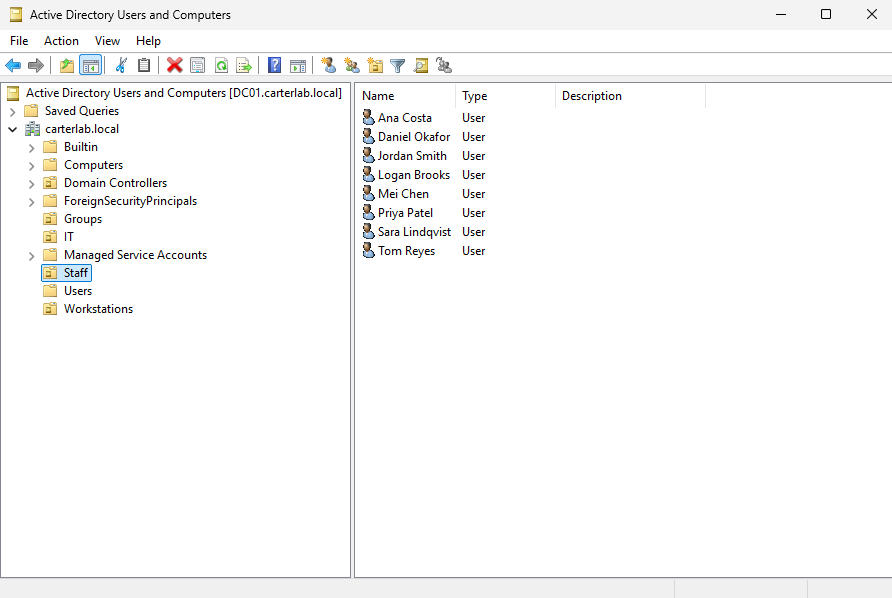
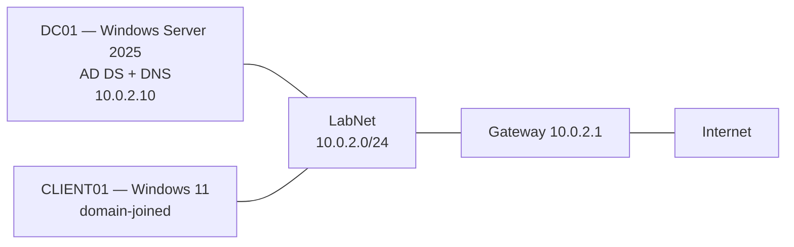

# Active Directory Home Lab

A Windows Server 2025 Active Directory environment modelling a small municipal
aquatics department, built in VirtualBox with PowerShell automation, Group
Policy, and five documented help desk scenarios.

## Lab diagram

## What I built
- Domain controller for `carterlab.local` running AD DS and DNS, with a
  forwarder for external lookups
- Four OUs and five role-based security groups, with ten users bulk-created
  from a CSV
- Domain password and account lockout policy
- A file share restricted to one group, with both share and NTFS permissions
- Two Group Policies: a drive map targeted at a single security group, and a
  Control Panel restriction for all staff
- A Windows 11 client joined to the domain and tested as three different
  users to confirm policy behaves by group membership

## Skills demonstrated
Active Directory · Group Policy · DNS · PowerShell · Windows Server 2025 ·
Windows 11 · NTFS and share permissions · virtualization · troubleshooting ·
technical documentation

## Help desk tickets
Five scenarios, each with investigation, root cause, resolution and
prevention. Index and scenario context in [tickets/](tickets/).

- [001 — Password reset](tickets/001-password-reset.md)
- [002 — Account locked out](tickets/002-account-locked-out.md)
- [003 — New hire needs access](tickets/003-new-hire-access.md)
- [004 — Mapped drive missing](tickets/004-mapped-drive-missing.md)
- [005 — No logon servers available](tickets/005-no-logon-servers.md)

## Build documentation
- [Lab network](docs/01-virtualbox-setup.md)
- [Domain controller: build, network and promotion](docs/02-domain-controller.md)
- [Users, groups and password policy](docs/03-users-and-groups.md)
- [File share and Group Policy](docs/04-group-policy.md)
- [Windows 11 client and domain join](docs/05-client-join.md)
- [Build log](docs/build-log.md) — dated entries for every session, including
  what went wrong

## Reproduce it
Scripts in [scripts/](scripts/), run in numbered order on a fresh Windows
Server VM. See [scripts/README.md](scripts/README.md) for what each one does.

## What I learned
The thing that really shocked me was how much of troubleshooting is just 
trying to figure out whether anything is actually broken. Three of my five 
ticket scenarios turned out to be configuration working exactly as designed, 
and the useful skill I started to pick up was learning how to tell that apart 
quickly rather than just knowing more commands.

The other lesson came from DNS. Active Directory depends on it completely, so
most of the failures I hit were really DNS failures that looked like something 
else, a domain join that couldn't find a server and a client that couldn't
log anyone in. Separating "can this machine reach it" from "can this machine
find it" solved more problems than pretty much anything else I did.

I also learned that systems hide their own failures. When I broke DNS
deliberately, users kept logging in because the DC Locator cache still knew
where the domain controller lived. That's why real outages can show up as "it
works for some people but not others" instead of everything stopping at once.
It's one thing to learn the theory behind these concepts, but a really cool 
experience to experiment and break them yourself then you can see how it all
works.

Writing it all down as I went turned out to be worth more than the build
itself. The build log tracks all my progress, mistakes and findings, and going 
back through those is how I actually understand and see all the things I did.