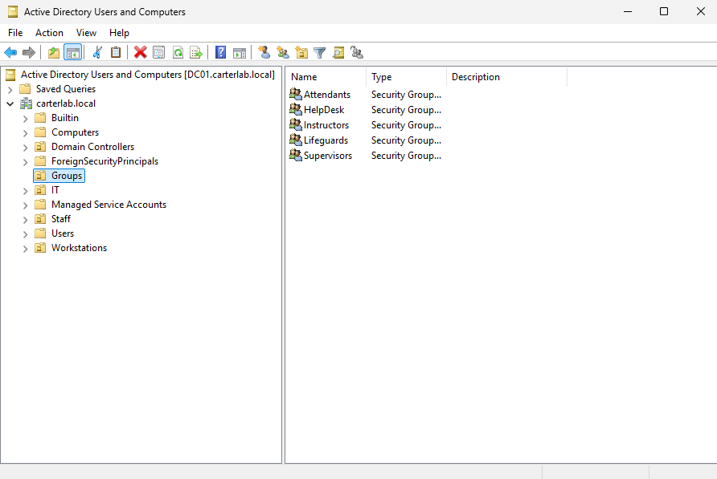
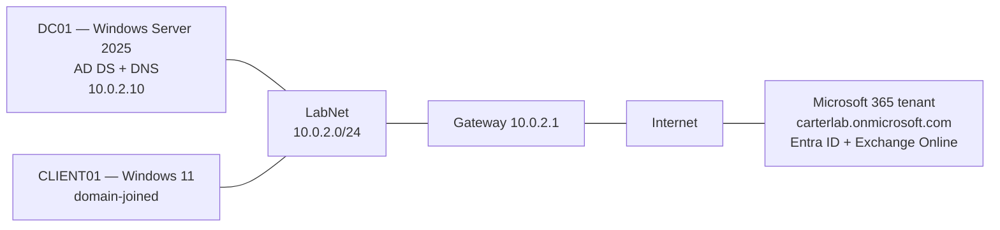

# Active Directory Home Lab

A Windows Server 2025 Active Directory environment modelling a small municipal
aquatics department, built in VirtualBox with PowerShell automation and Group
Policy, then extended with a Microsoft 365 tenant (Entra ID, Conditional
Access, Exchange Online). Eight help desk scenarios are documented across both.

## Lab diagram

## What I built

**On-premises**
- Domain controller for `carterlab.local` running AD DS and DNS, with a
  forwarder for external lookups
- Four OUs and five role-based security groups, with ten users bulk-created
  from a CSV
- Domain password and account lockout policy
- A file share restricted to one group, with both share and NTFS permissions
- Two Group Policies: a drive map targeted at a single security group, and a
  Control Panel restriction for all staff
- A Windows 11 client joined to the domain and tested as three different
  users to confirm policy behaves by group membership

**Microsoft 365**
- A Business Premium tenant with users licensed through a security group
  (group-based licensing)
- MFA enforced with a Conditional Access policy, with a break-glass admin
  excluded, and self-service password reset piloted to one group
- A shared help desk mailbox and an all-staff distribution list in Exchange
  Online, with Full Access and Send As permissions
- A documented offboarding process: block sign-in, revoke sessions, convert
  the mailbox to shared, hand it to the manager, reclaim the licence

## Skills demonstrated
Active Directory · Group Policy · DNS · PowerShell · Windows Server 2025 ·
Windows 11 · NTFS and share permissions · Microsoft 365 · Entra ID ·
Conditional Access · MFA · Exchange Online · licence management ·
virtualization · troubleshooting · technical documentation

## Help desk tickets
Help desk scenarios, each with investigation, root cause, resolution and
prevention. Index and scenario context in [tickets/](tickets/).

**On-premises Active Directory**
- [001 — Password reset](tickets/001-password-reset.md)
- [002 — Account locked out](tickets/002-account-locked-out.md)
- [003 — New hire needs access](tickets/003-new-hire-access.md)
- [004 — Mapped drive missing](tickets/004-mapped-drive-missing.md)
- [005 — No logon servers available](tickets/005-no-logon-servers.md)

**Microsoft 365**
- [006 — New hire has no Outlook licence](tickets/006-new-hire-no-license.md)
- [007 — Can't open the shared help desk mailbox](tickets/007-shared-mailbox-missing.md)
- [008 — New phone, can't complete MFA](tickets/008-mfa-new-phone.md)

## Build documentation
- [Lab network](docs/01-virtualbox-setup.md)
- [Domain controller: build, network and promotion](docs/02-domain-controller.md)
- [Users, groups and password policy](docs/03-users-and-groups.md)
- [File share and Group Policy](docs/04-group-policy.md)
- [Windows 11 client and domain join](docs/05-client-join.md)
- [Microsoft 365 and Entra ID](docs/06-microsoft-365-entra.md)
- [Build log](docs/build-log.md) — dated entries for every session, including
  what went wrong

## Reproduce it
Scripts in [scripts/](scripts/), run in numbered order on a fresh Windows
Server VM. See [scripts/README.md](scripts/README.md) for what each one does.
The Conditional Access policy is exported as JSON in
[ca-policies/](ca-policies/).

## What I learned
The thing that really shocked me was how much of troubleshooting is just 
trying to figure out whether anything is actually broken. Three of my five 
ticket scenarios turned out to be configuration working exactly as designed, 
and the useful skill I started to pick up was learning how to tell that apart 
quickly rather than just knowing more commands.

The other lesson came from DNS. Active Directory depends on it completely, so
most of the failures I hit were really DNS failures that looked like something 
else, a domain join that couldn't find a server and a client that couldn't
log anyone in. Separating "can this machine reach it" from "can this machine
find it" solved more problems than pretty much anything else I did.

I also learned that systems hide their own failures. When I broke DNS
deliberately, users kept logging in because the DC Locator cache still knew
where the domain controller lived. That's why real outages can show up as "it
works for some people but not others" instead of everything stopping at once.
It's one thing to learn the theory behind these concepts, but a really cool 
experience to experiment and break them yourself then you can see how it all
works.

Writing it all down as I went turned out to be worth more than the build
itself. The build log tracks all my progress, mistakes and findings, and going 
back through those is how I actually understand and see all the things I did.

Moving to Microsoft 365 showed me the same ideas carry over to the cloud.
Licences follow groups just like the L: drive did, and offboarding is the
onboarding checklist run backwards. What changed was how much of the job is
waiting and knowing it's normal: new mailboxes, licences and permissions all
took minutes to hours to show up, and a lot of "it's broken" turned out to be
"it isn't finished yet." The MFA ticket also made me think harder about
identity checks, because resetting someone's MFA hands their account to
whoever is on the phone.