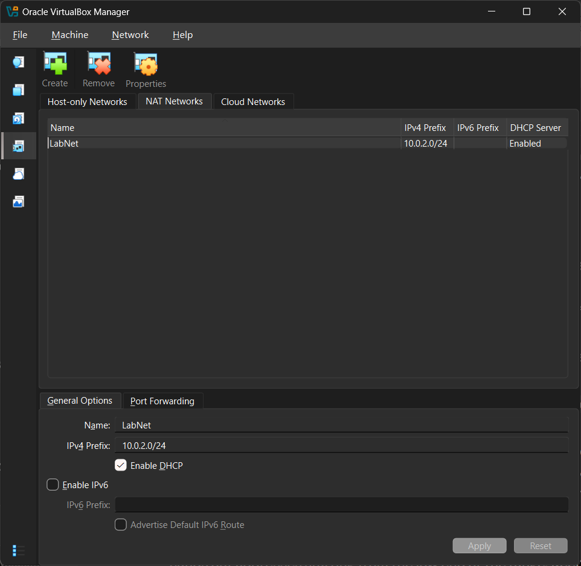

# Phase 1: Create the lab network

## Goal
Both VMs must be able to reach each other. Plain NAT gives each VM it's own isolated network, so they can't see each other. NAT Network puts them on one shared network. 

VirtualBox version: 7.2.20

## Steps
1. File
2. Tools (from dropdown menu)
3. Network (from dropdown menu)
4. Select NAT Networks tab 
5. Click create (green plus)
6. Rename 'LabNet'
7. Check that 'IPv4 Prefix: 10.0.2.0/24'
8. Check that 'Enable DHCP' is checked
9. Click apply

## Commands used
None. This phase was all in the VirtualBox interface.

## Screenshots

## Problems and fixes
(the menu path wasn't where the guide said; you found it under Preferences, then Network)

Initially I was unable to locate 'Network' under 'Tools'. Once I clicked 'Expert Mode' on 'Please Choose Experience Mode', 'Network' showed up.

## How I verified it worked
(LabNet appears in the NAT Networks list with 10.0.2.0/24 and DHCP enabled)

LabNet appears in NAT Networks list with prefix 10.0.2.0/24 and DHCP enabled. When I closed the Network tab and reopened it, LabNet was still there, so it saved.