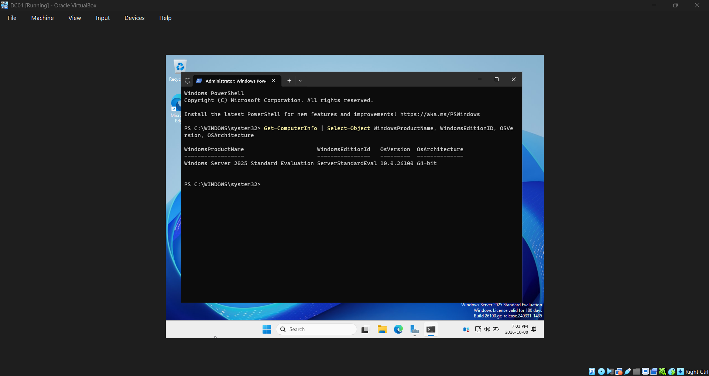
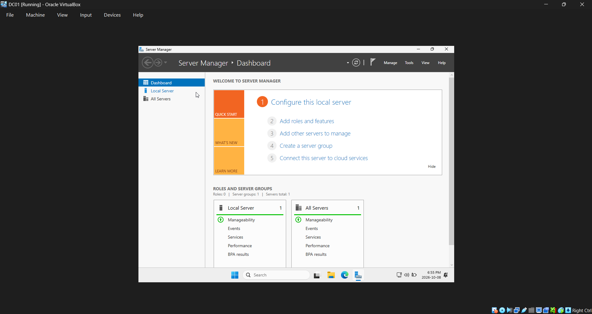
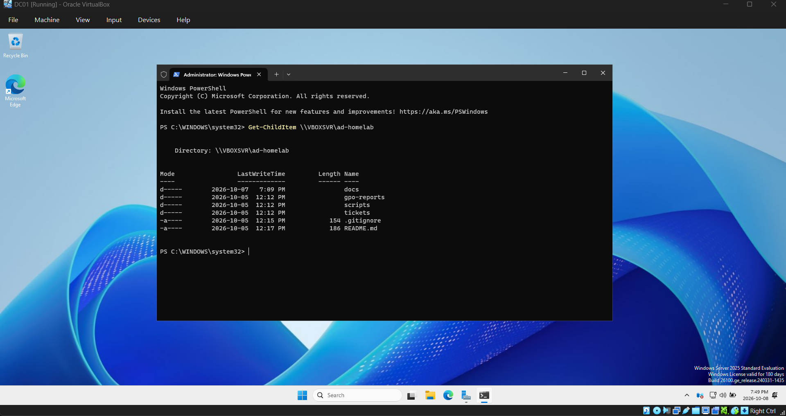
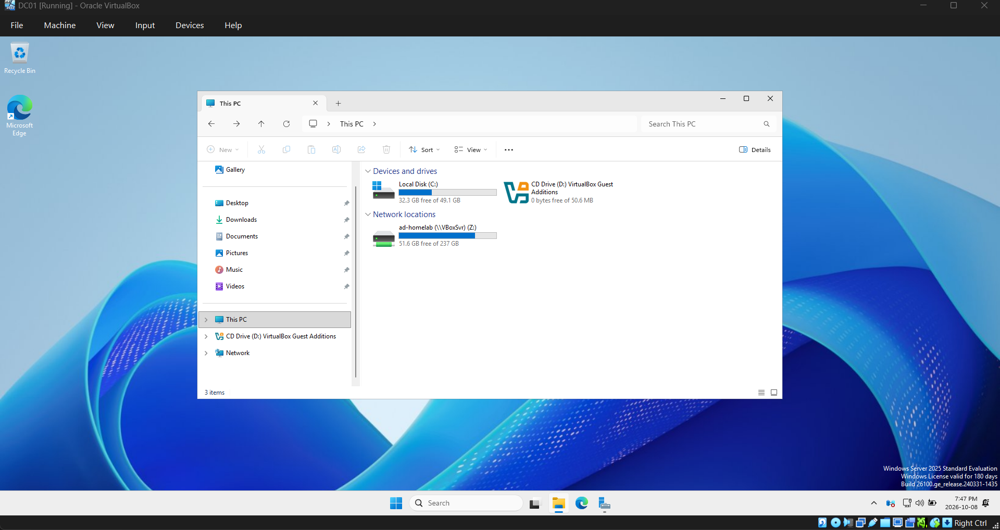
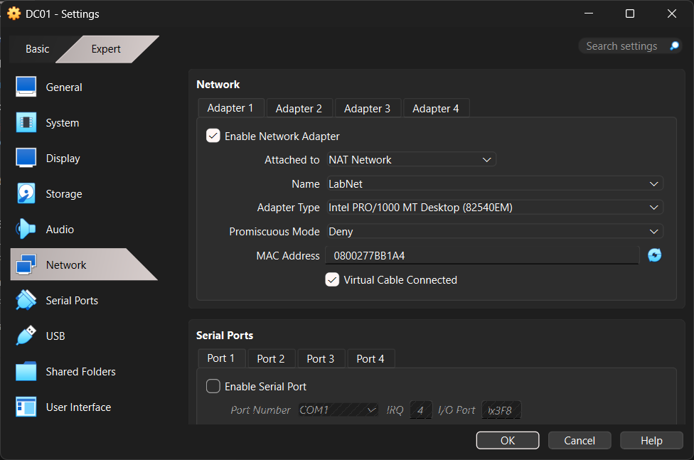

# Phase 2: Build the domain controller VM

## Part 1: VM build and Windows Server install

## Goal
Create the VM that will be the domain controller, install Windows Server 2025 and then connect it to the lab network and my repo folder.

Settings and why:
- 4096 MB RAM, 2 CPUs: enough for AD DS and DNS. Dropped to 3072 MB in Phase 8
  so CLIENT01 can run at the same time on 16 GB.
- 50 GB dynamic disk: Server needs about 30 GB installed. Dynamic means the .vdi
  only grows as it fills, instead of claiming 50 GB up front.
- Standard Evaluation with Desktop Experience: the GUI tools I'm learning
  (Server Manager, ADUC, Group Policy Management) need the desktop. Free for 180 days.
- NAT Network "LabNet": so DC01 and CLIENT01 can see each other and still reach
  the internet.
- Shared folder instead of copying files in: scripts stay in one place, edited
  in VS Code on my PC and run in the VM.

## Steps
1. In VirtualBox: New > Name: DC01, ISO from C:\ISOs, Skip Unattended Installation
2. 4096 MB Memory, 2 CPUs, 50 GB disk, not preallocated
3. Settings in DC01 > Network: Adapter 1 to NAT Network, Name: LabNet
4. Settings > General > Features: Shared Clipboard Bidirectional
5. Installed Windows Server 2025 Standard Evaluation (Desktop Experience)
6. Set the Administrator password (stored in a password manager, not in this repo)
7. Devices > Insert Guest Additions CD image, ran VBoxWindowsAdditions.exe
8. Settings > Shared Folders: C:\Projects\ad-homelab as "ad-homelab", auto-mount
9. sconfig: Windows Update to Manual, time zone to Eastern
10. Removed both ISOs from the virtual drive, deleted the Server ISO from C:\ISOs

## Commands used
```powershell
Get-ComputerInfo | Select-Object WindowsProductName, WindowsEditionId, OsVersion, OsArchitecture
Get-Service VBoxService
Get-ChildIte, \\VBOXSVR\ad-homelab
sconfig
```

## Screenshots






## Problems and fixes
Missed the edition selection screenshot during install. Captured the same
information afterwards with Get-ComputerInfo instead.

The reboot after Guest Additions hung on "Restarting" for about 9 minutes with
no disk activity. Forced a power off from VirtualBox and started the VM again;
it came back cleanly. Window auto-resize didn't work intially, but I checked that Get-Service
VBoxService showed Running and the shared folder works, so the parts I needed were fine. Later I was able to get window auto-resize to work. 

## How I verified it worked
Get-ComputerInfo confirmed Windows Server 2025 Standard Evaluation, 64-bit.
Get-Service VBoxService returned Running.
Get-ChildItem \\VBOXSVR\ad-homelab listed README.md, .gitignore and the repo
folders, which proves both Guest Additions and the shared folder are working.
