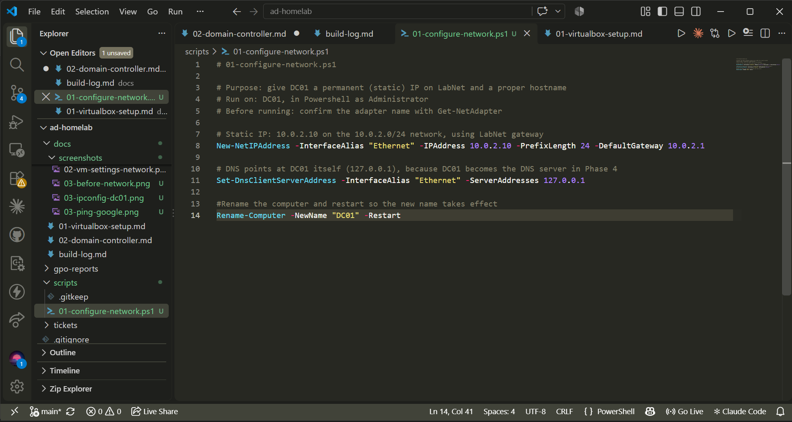
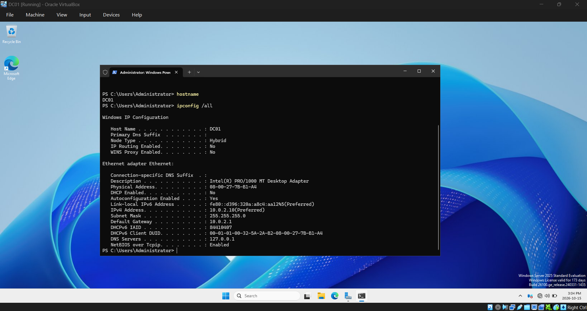
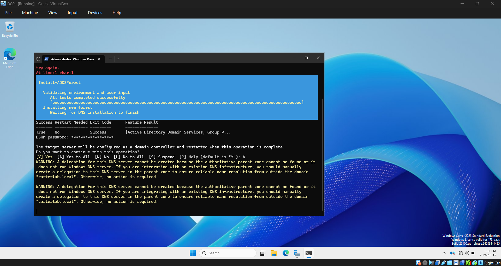
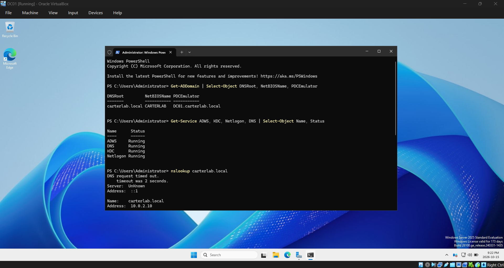
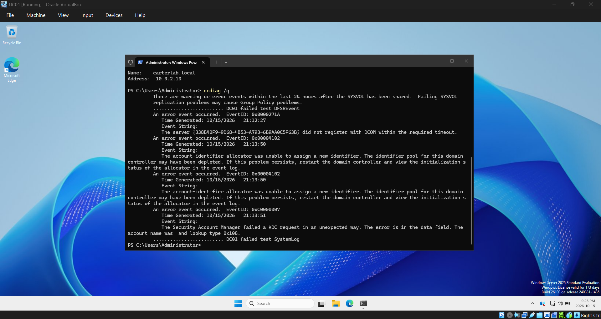
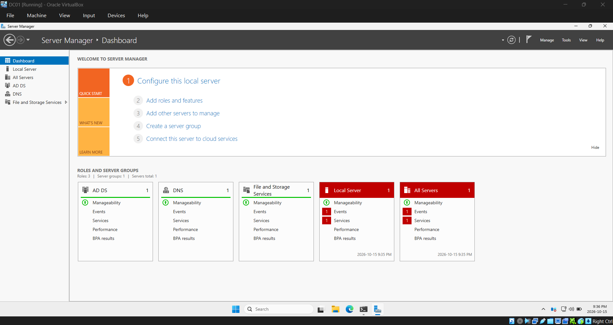
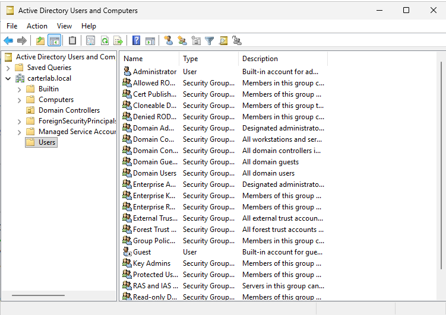
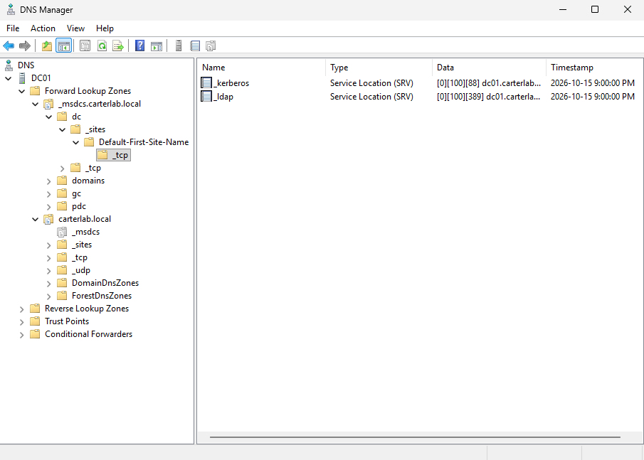

# Phase 2: Build the domain controller VM

## Part 1: VM build and Windows Server install

## Goal
Create the VM that will be the domain controller, install Windows Server 2025 and then connect it to the lab network and my repo folder.

Settings and why:
- 4096 MB RAM, 2 CPUs: enough for AD DS and DNS. Dropped to 3072 MB in Phase 8
  so CLIENT01 can run at the same time on 16 GB.
- 50 GB dynamic disk: Server needs about 30 GB installed. Dynamic means the .vdi
  only grows as it fills, instead of claiming 50 GB up front.
- Standard Evaluation with Desktop Experience: the GUI tools I'm learning
  (Server Manager, ADUC, Group Policy Management) need the desktop. Free for 180 days.
- NAT Network "LabNet": so DC01 and CLIENT01 can see each other and still reach
  the internet.
- Shared folder instead of copying files in: scripts stay in one place, edited
  in VS Code on my PC and run in the VM.

## Steps
1. In VirtualBox: New > Name: DC01, ISO from C:\ISOs, Skip Unattended Installation
2. 4096 MB Memory, 2 CPUs, 50 GB disk, not preallocated
3. Settings in DC01 > Network: Adapter 1 to NAT Network, Name: LabNet
4. Settings > General > Features: Shared Clipboard Bidirectional
5. Installed Windows Server 2025 Standard Evaluation (Desktop Experience)
6. Set the Administrator password (stored in a password manager, not in this repo)
7. Devices > Insert Guest Additions CD image, ran VBoxWindowsAdditions.exe
8. Settings > Shared Folders: C:\Projects\ad-homelab as "ad-homelab", auto-mount
9. sconfig: Windows Update to Manual, time zone to Eastern
10. Removed both ISOs from the virtual drive, deleted the Server ISO from C:\ISOs

## Commands used
```powershell
# Confirm which Windows edition and build actually installed
Get-ComputerInfo | Select-Object WindowsProductName, WindowsEditionId, OsVersion, OsArchitecture

# Check Guest Additions installed correctly (Status should be Running)
Get-Service VBoxService

# List the shared repo folder from inside the VM, proving the share works
Get-ChildItem \\VBOXSVR\ad-homelab

# Server config menu: set Windows Update to Manual and the time zone to Eastern
sconfig
```

## Screenshots


## Problems and fixes
Missed the edition selection screenshot during install. Captured the same
information afterwards with Get-ComputerInfo instead.

The reboot after Guest Additions hung on "Restarting" for about 9 minutes with
no disk activity. Forced a power off from VirtualBox and started the VM again;
it came back cleanly. Window auto-resize didn't work intially, but I checked that Get-Service
VBoxService showed Running and the shared folder works, so the parts I needed were fine. Later I was able to get window auto-resize to work. 

## How I verified it worked
Get-ComputerInfo confirmed Windows Server 2025 Standard Evaluation, 64-bit.
Get-Service VBoxService returned Running.
Get-ChildItem \\VBOXSVR\ad-homelab listed README.md, .gitignore and the repo
folders, which proves both Guest Additions and the shared folder are working.


## Part 2: Static IP and hostname with PowerShell

## Goal:
Give DC01 its permanent address and name using a script. 

## Steps:
1. In VS code, write 01-configure-network script
2. In VM PowerShell, run: 
  - Set-ExecutionPolicy Bypass -Scope Process
  - Set-Location \\VBOXSVR\ad-homelab\scripts
  - Get-NetAdapter
  - .\01-configure-network.ps1
3. Check that Get-NetAdapter shows name as "Ethernet"
4. VM restarts, then log back in
5. Verify changes worked:
  - hostname: DC01
  - ipconfig /all: 
    - IPv4 address: 10.0.2.10
    - subnet mask: 255.255.255.0
    - gateway: 10.0.2.1
    - DNS server: 127.0.0.1


## Commands used:
```powershell
# Find the adapter name before running the script
Get-NetAdapter

# Allow the script to run in this window only, then run it from the shared folder
Set-ExecutionPolicy Bypass -Scope Process -Force
\\VBOXSVR\ad-homelab\scripts\01-configure-network.ps1

# After the restart, verify
hostname                 # prints DC01
ipconfig /all            # 10.0.2.10, mask 255.255.255.0, gateway 10.0.2.1, DNS 127.0.0.1
ping 10.0.2.1            # gateway replies
ping 8.8.8.8             # internet routing works
ping google.com          # fails: no DNS server on this box yet, fixed in Phase 4
```

## Screenshots:




## Problems and fixes:
Didn't capture the adapter's DHCP address before running the script, so there's
no before/after pair for this phase. Will take a before shot on CLIENT01 in Phase 8.

After the script ran, `ping google.com` failed with "could not find host" while
`ping 8.8.8.8` replied fine. Not a fault: the script points DNS at 127.0.0.1 and
there's no DNS server on the box until AD DS installs one in Phase 4. Routing out
works, name resolution doesn't. Phase 4.3 will fix it with a forwarder.

## How I verified it worked:
`hostname` returned DC01, so the rename took effect after the restart.
`ipconfig /all` showed 10.0.2.10, mask 255.255.255.0, gateway 10.0.2.1, DNS 127.0.0.1,
which matches what the script set.
`ping 10.0.2.1` got replies, confirming DC01 can reach the LabNet gateway.
`ping 8.8.8.8` got replies, confirming the NAT Network still routes to the internet.


## Part 3: Promotion to domain controller

## Goal:
Install AD DS and promote DC01 to the first domain controller in a new
forest, carterlab.local.

A domain controller is the server that holds the directory of every user,
group and computer in the organization, and answers the question "is this
person who they say they are, and what are they allowed to do?" Every login,
every permission check and every policy that applies to a machine traces back
to it. Without one, every PC keeps its own separate list of accounts and
nothing is managed centrally.

## Steps:
1. Wrote scripts/02-install-adds.ps1
2. Ran it in an admin PowerShell window on DC01
3. Set the DSRM password (stored in a password manager, not in this repo)
4. Waited through the promotion and automatic restart
5. Logged in as CARTERLAB\Administrator
6. Ran the verification commands
7. Added a DNS forwarder so outside lookups resolve
8. Took a VirtualBox snapshot named "Clean DC"

## Commands used:
```powershell
# Install the role and promote this server to a new forest
Set-ExecutionPolicy Bypass -Scope Process -Force
\\VBOXSVR\ad-homelab\scripts\02-install-adds.ps1

# Verify after the restart
Get-ADDomain
Get-ADDomainController
Get-Service NTDS, DNS, Netlogon
nslookup carterlab.local

# Forward external lookups to a public DNS server
Add-DnsServerForwarder -IPAddress 8.8.8.8
ping google.com
```

## Screenshots:







## Problems and fixes:
Server Manager showed two DNS warnings from boot (4013 and 4017) and a red
Local Server tile. 4013 is DNS waiting for AD to finish its initial sync,
normal on a single DC. The red tile was InventorySvc, a Windows compatibility
service set to Automatic (Delayed Start) that wasn't running. Neither affects
AD. AD DS and DNS both showed green and the verification commands came back
clean.

## How I verified it worked:
Get-ADDomain returned carterlab.local with DC01 listed.
Get-ADDomainController confirmed DC01 as a domain controller.
NTDS, DNS and Netlogon were all Running.
nslookup carterlab.local resolved to 10.0.2.10.
ping google.com started working after the forwarder was added, which fixed
the failure I documented in Phase 3.