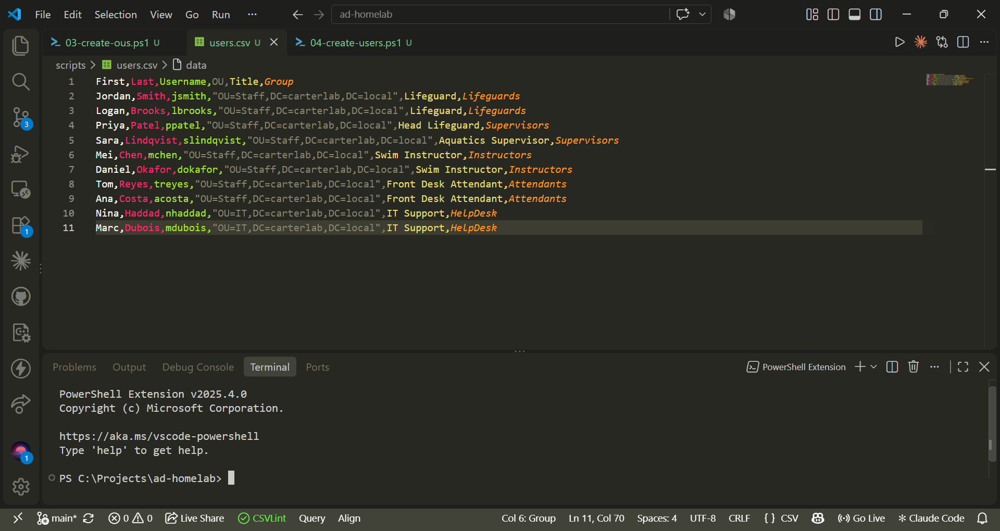
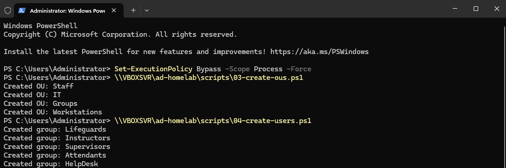
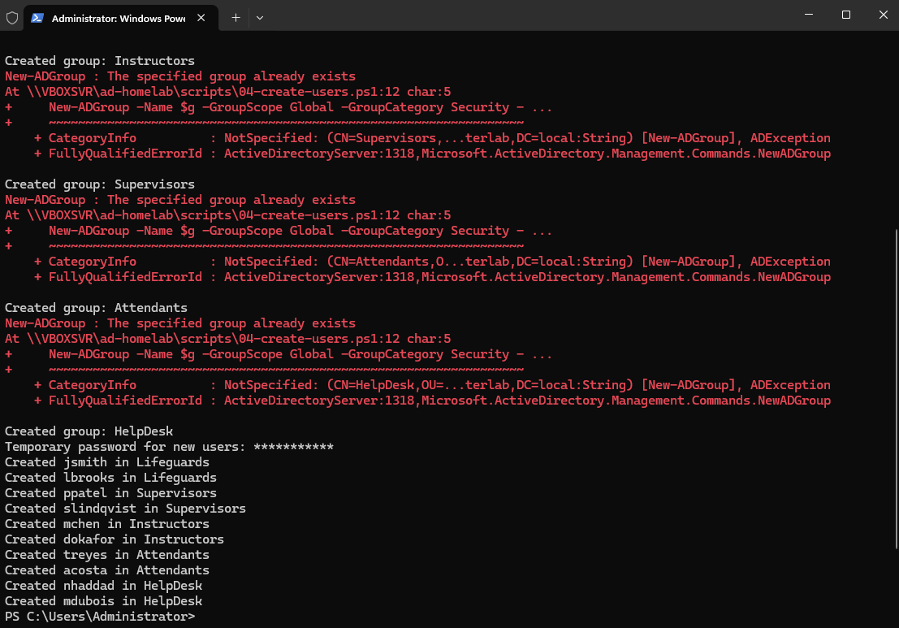
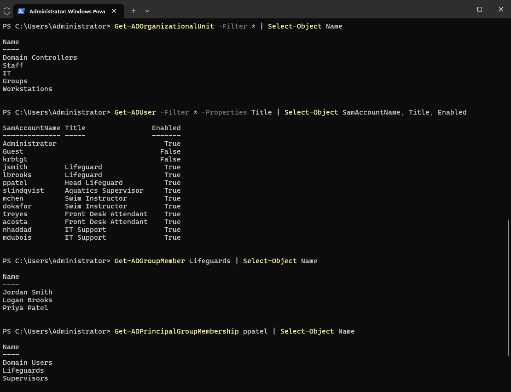
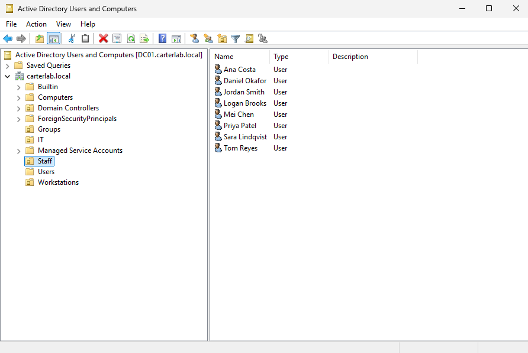
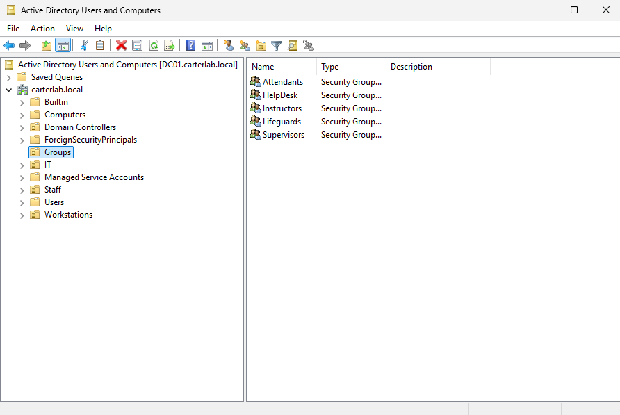
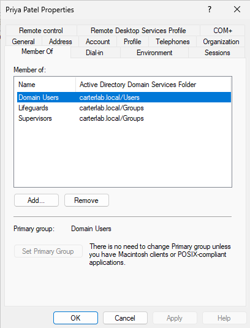

# Phase 5: OUs, groups and users

## Goal:
Build the directory structure for a small aquatics department: four OUs, five
role-based security groups, and ten users imported from a CSV.

OU layout and why:
- **Staff** — the eight aquatics and facilities people. Group Policy links here
  in Phase 7, so everyone who needs the mapped drive and the Control Panel
  restriction sits in one place.
- **IT** — the two help desk accounts, kept separate so IT staff don't inherit
  the restrictions aimed at general staff.
- **Groups** — all security groups, so they're easy to find and don't clutter
  the user OUs.
- **Workstations** — for computer objects. CLIENT01 moves here in Phase 8, so
  computer policies can target machines rather than people.

Group design: one group per job role at the pool — Lifeguards, Instructors,
Supervisors, Attendants, HelpDesk. Access is granted to groups, never to
individual users. Add someone to Lifeguards and they get everything lifeguards
get; remove them and it's gone. With ten users that's convenient, with a
thousand it's the only workable approach, and it means an access review is a
question about five groups instead of a thousand accounts.

Head lifeguards supervise and still take a chair, so ppatel is in both
Supervisors and Lifeguards. The aquatics supervisor doesn't guard, so she's in
Supervisors only. That overlap is why membership and job title are tracked
separately: the Title field says what someone does, the groups say what they
can reach.

## Steps:
1. Created one OU and one user by hand in ADUC first, clicked through every
   Properties tab, then deleted both
2. Wrote scripts/03-create-ous.ps1 for the four OUs
3. Wrote scripts/users.csv with ten fake users, including a Title column
4. Wrote scripts/04-create-users.ps1 to create the five groups and import users
5. Ran both scripts from the shared folder on DC01
6. Added ppatel to Lifeguards as a second group
7. Verified in PowerShell and in ADUC

## Commands used:
```powershell
Set-ExecutionPolicy Bypass -Scope Process -Force
\\VBOXSVR\ad-homelab\scripts\03-create-ous.ps1
\\VBOXSVR\ad-homelab\scripts\04-create-users.ps1

# Verify
Get-ADOrganizationalUnit -Filter * | Select-Object Name
Get-ADUser -Filter * -Properties Title | Select-Object SamAccountName, Title, Enabled
Get-ADGroupMember Lifeguards | Select-Object Name
Get-ADPrincipalGroupMembership ppatel | Select-Object Name
```

## Screenshots:
## Screenshots








## Problems and fixes:
The first run of 04-create-users.ps1 failed with "Could not find file
C:\Users\Administrator\users.csv". The script used `.\users.csv`, which
resolves against the caller's current directory, not the script's own folder.
I was running it by full UNC path from my home directory, so PowerShell looked
in the wrong place. Fixed with `Import-Csv (Join-Path $PSScriptRoot "users.csv")`,
which always resolves next to the script.

Re-running the script threw "group already exists" five times, then printed
"Created group" for each one anyway. Write-Host runs whether or not the
command before it succeeded, so the script was reporting success on failure.
Rewrote the loop to check with Get-ADGroup first, which makes the script safe
to run twice and honest about what it did.

## How I verified it worked:
All four OUs appeared in Get-ADOrganizationalUnit.
All ten users listed as Enabled with their job titles populated from the CSV.
Get-ADGroupMember Lifeguards returned jsmith, lbrooks and ppatel.
Get-ADPrincipalGroupMembership ppatel returned both Supervisors and Lifeguards,
confirming the second group add worked.
ADUC showed the Staff OU holding eight users and the Groups OU holding the five
security groups.