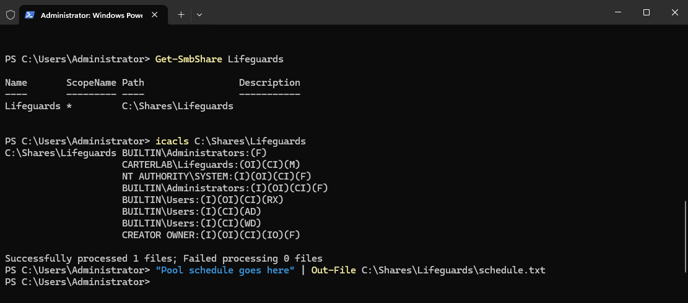
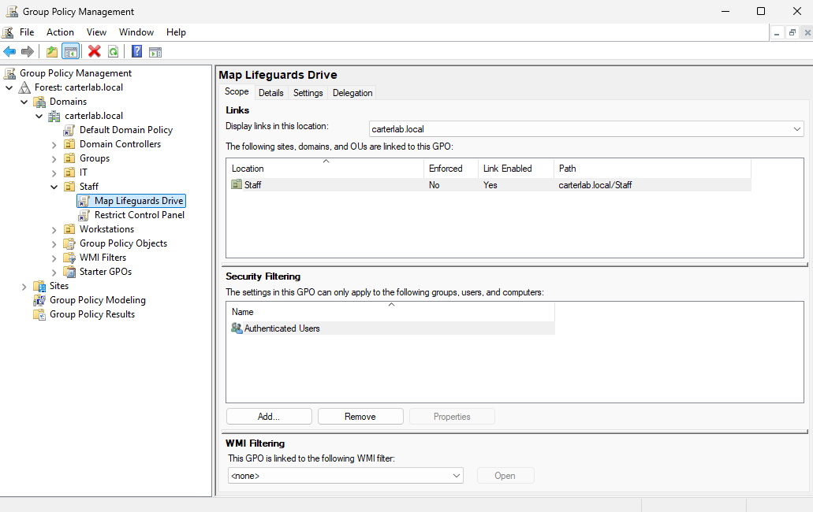
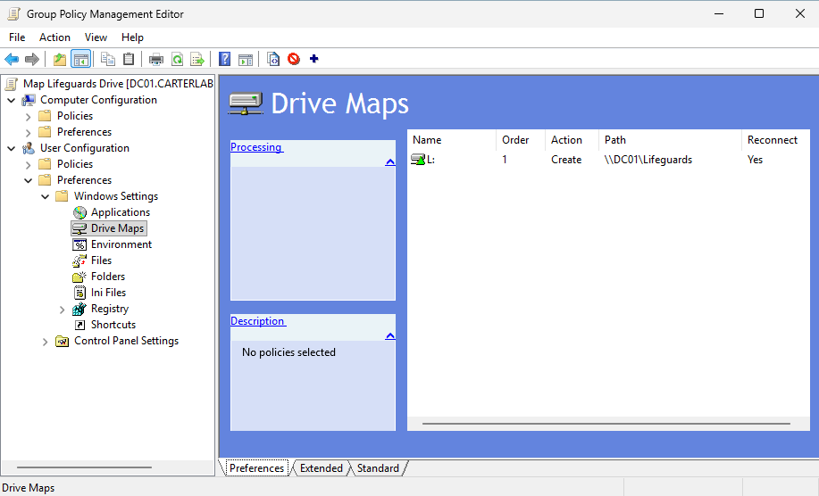
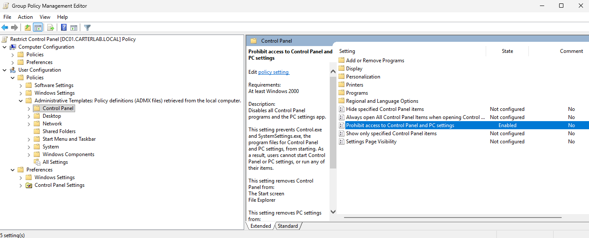
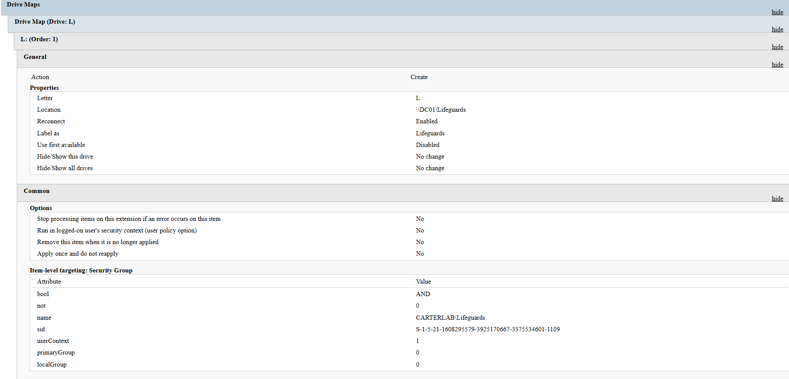

# File share and Group Policy

## Goal
Create a file share only lifeguards can reach, then deliver it automatically
as an L: drive to the right people, and restrict Control Panel for all staff.

### The share and its two permission layers
`C:\Shares\Lifeguards`, shared as `\\DC01\Lifeguards`.

Two separate locks sit on the same folder:

- **Share permissions** apply only to connections over the network. This
  share's ACL contains one entry: CARTERLAB\Lifeguards, Full.
- **NTFS permissions** apply always, locally and remotely. The script grants
  Lifeguards Modify with (OI)(CI) so it inherits to files and subfolders.

Effective access is the more restrictive of the two, so a lifeguard connecting
over the network gets Modify, not Full.

Worth noting what `icacls` actually shows: alongside the explicit Lifeguards
entry there are inherited `(I)` entries from C:\ giving BUILTIN\Users Read &
Execute plus create-file and create-folder rights. So NTFS alone is **not**
restricting this folder to lifeguards — the share permission is what keeps
everyone else out over the network. Anyone logged on to DC01 locally could
still read it.

Production usually does the opposite of this: share permissions wide
(Authenticated Users, Full) and NTFS tight, because NTFS applies in both
directions. The tidy version here would be `icacls /inheritance:r` to break
inheritance, then grant explicitly.

### The two GPOs

**Map Lifeguards Drive** — linked to the Staff OU.
User Configuration > Preferences > Windows Settings > Drive Maps.
Creates drive L: pointing at `\\DC01\Lifeguards`, labelled "Lifeguards", with
Reconnect enabled. It's a Preference rather than a Policy, so it sets a
starting value the user could in principle change, rather than enforcing one.

**Restrict Control Panel** — linked to the Staff OU.
User Configuration > Policies > Administrative Templates > Control Panel >
"Prohibit access to Control Panel and PC settings" = Enabled. This is a
Policy, so it's enforced and the user can't undo it.

Both live under User Configuration because both follow the person rather than
the machine. A mapped drive letter and a Control Panel restriction belong to
who is logged in, not to the PC. Computer Configuration has no Drive Maps node
at all.

### Item-level targeting, in my own words
The GPO applies to everyone in the Staff OU, its Security Filtering is set to
Authenticated Users. That's too broad for the drive map, because attendants and
instructors shouldn't get a lifeguards-only share.

Item-level targeting is a filter inside the preference itself. It says "only
apply this drive map if the user is a member of CARTERLAB\Lifeguards." So one
GPO reaches all staff, and the individual preference inside it decides who
actually gets the drive.

These are two different filters doing two different jobs, and they're easy to
confuse. Security Filtering controls who the GPO applies to. Item-level
targeting controls who a single preference inside it applies to. Using the
targeting means I don't need a second GPO and a second link just to carve out
one group, and membership is evaluated at logon, so adding someone to
Lifeguards gives them the drive without touching Group Policy at all.

## Steps
1. Wrote and ran scripts/06-create-share.ps1 to create the folder, the share
   and the NTFS grant
2. Added schedule.txt so the share has visible contents for testing
3. Created the "Map Lifeguards Drive" GPO and linked it to Staff
4. Added a Drive Maps preference: Create, L:, \\DC01\Lifeguards, Reconnect
5. Added item-level targeting on the Lifeguards security group
6. Created the "Restrict Control Panel" GPO and linked it to Staff
7. Enabled "Prohibit access to Control Panel and PC settings"
8. Exported both GPOs as HTML reports into gpo-reports/

## Commands used
```powershell
Set-ExecutionPolicy Bypass -Scope Process -Force
\\VBOXSVR\ad-homelab\scripts\06-create-share.ps1

# Verify
Get-SmbShare Lifeguards
icacls C:\Shares\Lifeguards
"Pool schedule goes here" | Out-File C:\Shares\Lifeguards\schedule.txt
```

## Reports
- [Map Lifeguards Drive](../gpo-reports/map-lifeguards-drive.html)
- [Restrict Control Panel](../gpo-reports/restrict-control-panel.html)

## Screenshots







## Problems and fixes
Looked for Drive Maps under Computer Configuration first and couldn't find it.
It only exists under User Configuration, because a mapped drive belongs to a
person rather than a machine.

DC01 froze during this phase and had to be powered off from VirtualBox
Manager. Windows logged Kernel-Power 41 on the next boot, which is just it
noting the unclean shutdown. No damage, but ACPI Shutdown is the right first
move — a DC killed mid-write can corrupt the AD database.

## How I verified it worked
Get-SmbShare confirmed the share exists at C:\Shares\Lifeguards.
icacls showed the explicit Lifeguards:(OI)(CI)(M) grant.
Both GPO reports confirm the links to carterlab.local/Staff, GPO Status
Enabled, and the settings as configured, including the targeting SID
S-1-5-21-...-1109 with userContext 1 (user in group, not computer).
Full end-to-end proof comes in Phase 8, when real users log in to CLIENT01.