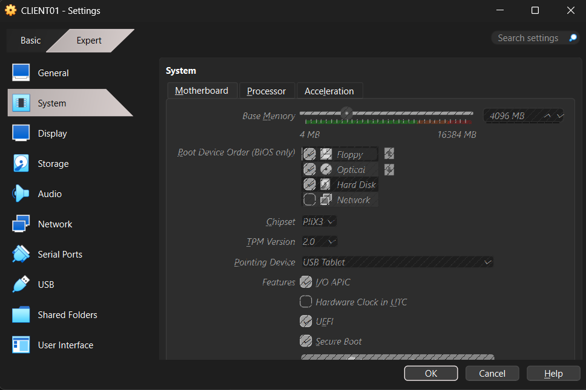
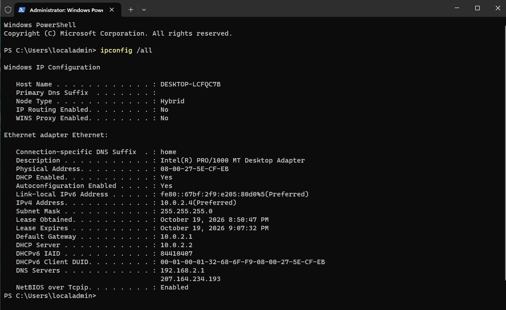
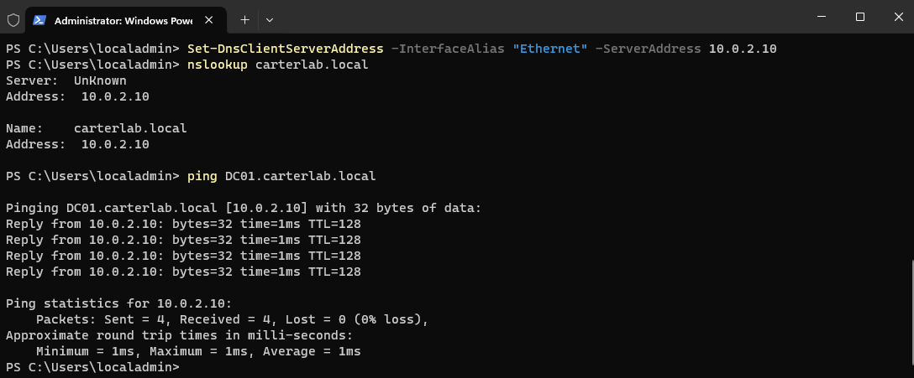
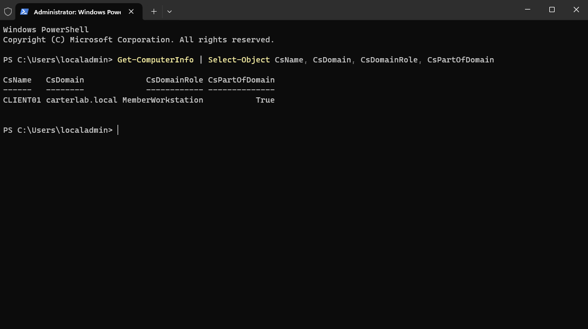
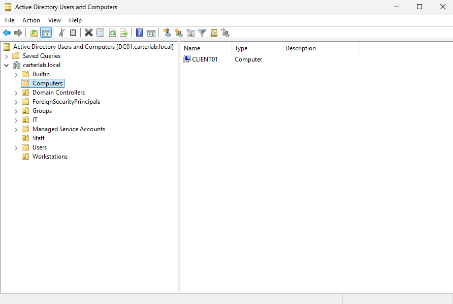
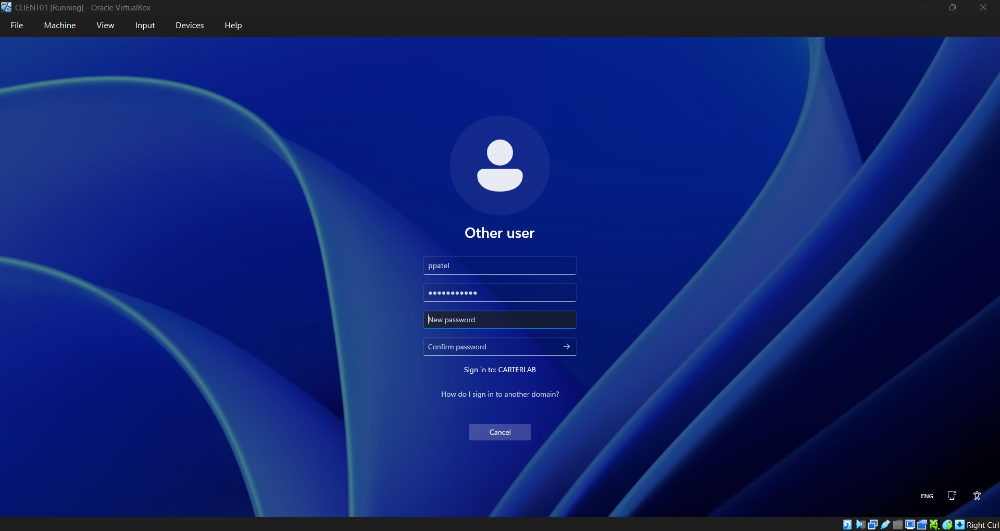
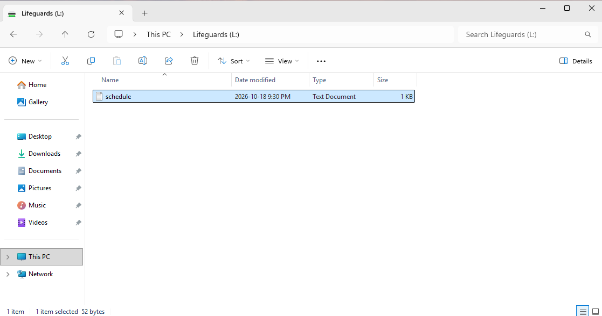
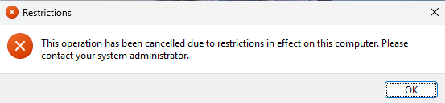
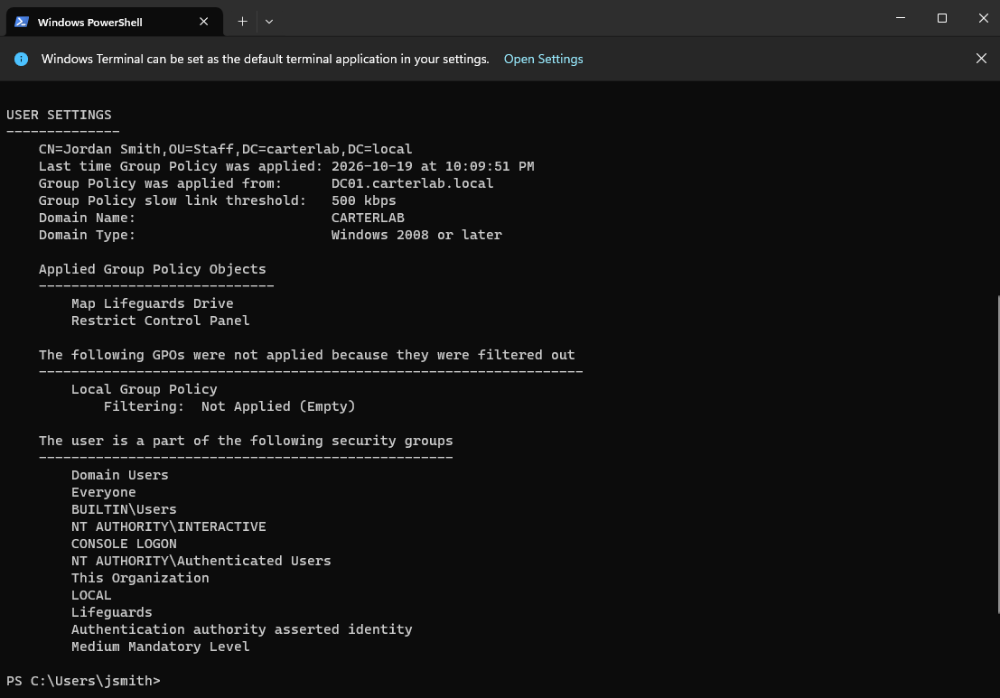
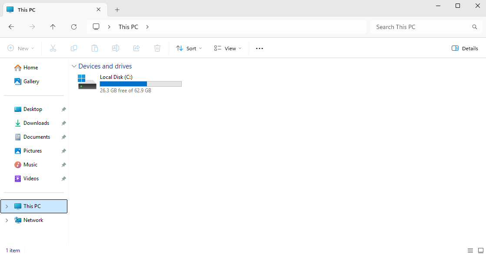

# Windows 11 client and domain join

## Goal:
Build a Windows 11 workstation, join it to carterlab.local, and prove the
Group Policy work from Phase 7 actually reaches real users.

### Why DNS comes first:
A client doesn't know domain controllers exist. It knows a domain name, and
nothing else. To join, it has to ask DNS "who handles carterlab.local?" and
read back the SRV records that AD DS registered in Phase 4 — the ones naming
DC01 at 10.0.2.10 on port 389.

Out of the box CLIENT01 took its DNS servers from LabNet's DHCP, which handed
down my home router and my ISP (192.168.2.1 and 207.164.234.193). Neither has
ever heard of carterlab.local. So the join had nowhere to look, which is why
DNS gets pointed at DC01 before anything else is attempted.

## Steps:
1. Created the CLIENT01 VM: 4096 MB, 2 CPUs, 64 GB dynamic disk, EFI, TPM 2.0,
   Secure Boot, Adapter 1 on NAT Network LabNet
2. Lowered DC01 to 3072 MB so both VMs fit in 16 GB of host RAM
3. Installed Windows 11 Enterprise with a local account, localadmin
4. Installed Guest Additions and paused Windows Update
5. Pointed DNS at DC01 and verified resolution
6. Renamed the machine to CLIENT01 and restarted
7. Joined carterlab.local
8. Moved the computer object from the default Computers container into the
   Workstations OU
9. Logged in as real users and tested the policies

## Commands used:
```powershell
# Before: DNS came from DHCP and couldn't resolve the domain
ipconfig /all

# Point DNS at the domain controller
Set-DnsClientServerAddress -InterfaceAlias "Ethernet" -ServerAddress 10.0.2.10
nslookup carterlab.local
ping DC01.carterlab.local

# Rename, then join
Rename-Computer -NewName "CLIENT01" -Restart
Add-Computer -DomainName "carterlab.local" -Credential CARTERLAB\Administrator -Restart

# Confirm the end state
Get-ComputerInfo | Select-Object CsName, CsDomain, CsDomainRole, CsPartOfDomain

# As each test user
gpresult /r
```

## Test results:
| User | Group | L: drive | Control Panel | Why |
|---|---|---|---|---|
| jsmith | Lifeguards | Yes | Blocked | In Staff OU so both GPOs apply; in Lifeguards so the drive map's item-level targeting matches |
| mchen | Instructors | No | Blocked | Same OU, same GPOs, but the targeting checks for Lifeguards membership and she isn't a member, so the preference is skipped |
| ppatel | Supervisors + Lifeguards | Yes | Blocked | Head lifeguard, so she holds both groups; the targeting matches on Lifeguards |

## Screenshots:











## Problems and fixes:
The Windows 11 installer wouldn't start: I missed the five-second "Press any
key to boot from CD or DVD" prompt and the VM fell through to "No bootable
option or device was found". Reset the VM, clicked inside the window first so
it captured the keyboard, and pressed a key straight away.

Inserting the Guest Additions CD image appeared to do nothing. It mounts the
ISO silently and Windows 11 has autorun disabled, so the installer has to be
run by hand from the CD drive in File Explorer.

The domain join failed with "The specified domain either does not exist or
could not be contacted". DC01 wasn't running. Worth noting that it failed
before prompting for credentials, which points at name resolution or
reachability rather than a password problem. Started DC01, waited for AD
services to come up, and the join succeeded.

Add-Computer -Restart gave no window to read its output before the machine
rebooted. Captured the end state afterwards with Get-ComputerInfo instead,
which proves domain membership more directly than the join message did.

Free disk space dropped to 16 GB during this phase. Deleted the Windows 11
ISO and the "Clean DC" snapshot, which recovered enough to finish, and skipped
the optional "Joined client" snapshot.

## How I verified it worked:
nslookup carterlab.local resolved to 10.0.2.10 and CLIENT01 could ping
DC01 by name.
Get-ComputerInfo returned CsName CLIENT01, CsDomain carterlab.local and
CsPartOfDomain True.
CLIENT01 appeared as a computer object in Active Directory.
jsmith was forced to change her password at first login, which is the
-ChangePasswordAtLogon flag set back in Phase 5.
jsmith got the L: drive with schedule.txt in it and was blocked from Control
Panel; gpresult /r listed both GPOs under applied user policy.
mchen got the Control Panel block but no L: drive, confirming the item-level
targeting filters the preference rather than the GPO.