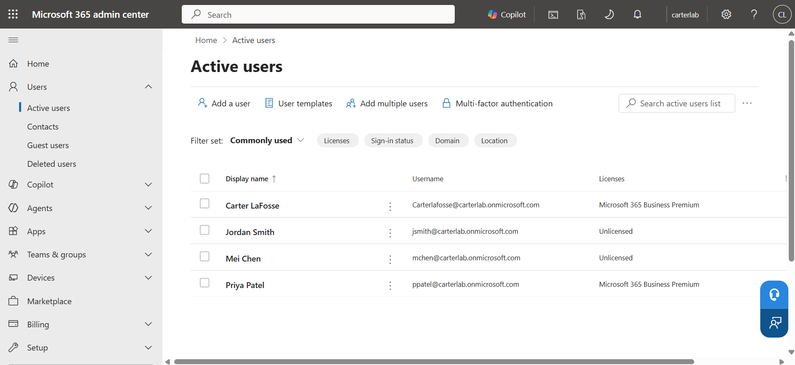
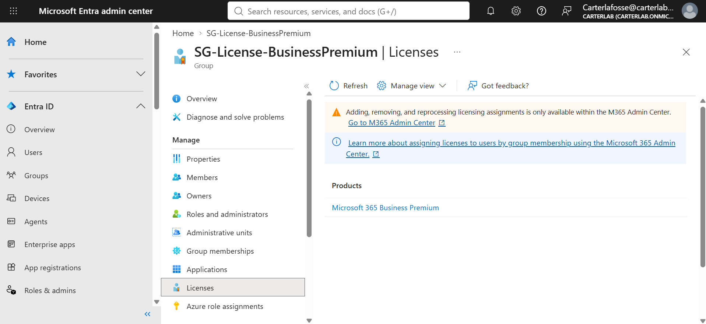
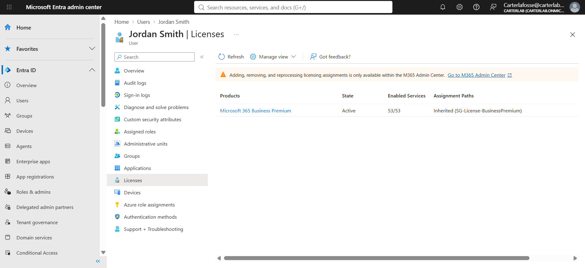
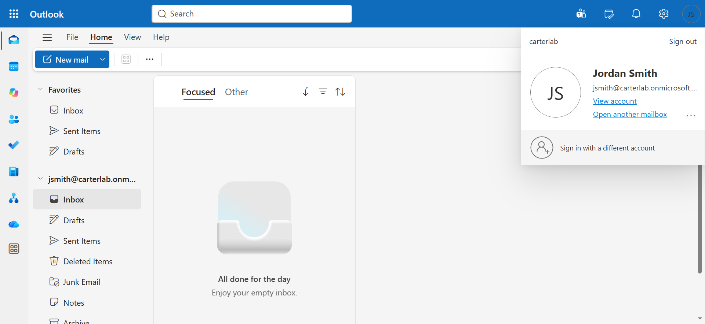

# Microsoft 365 and Entra ID

## Goal:
Extend the lab with a Microsoft 365 tenant and practise the cloud side of
help desk work: licences, MFA, password resets, shared mailboxes and
offboarding. The users are the same people as in the on-premises lab, so
both halves read as one organization.

## Tenant:
- Tenant: carterlab.onmicrosoft.com
- Subscription: Microsoft 365 Business Premium (30-day trial, 25 licences,
  Nov 9 to Dec 8, 2026)
- Admin centres used: Microsoft 365 admin center, Microsoft Entra admin
  center, Exchange admin center

## 1. Users, groups and licences

### Why group-based licensing:
In the on-premises lab, access follows role groups. Add someone to
Lifeguards and the L: drive appears; remove them and it's gone. Licences
work the same way here. Instead of assigning a licence to each person, I
assigned Business Premium to one security group, SG-License-BusinessPremium.
Onboarding a new user becomes one step (add them to the group), and
removing them from the group takes the licence back automatically.

I gave Priya a direct licence on purpose to show the difference. Her
licence page shows the assignment path as Direct, while Jordan's shows
Inherited from the group. In a real tenant, direct assignments are the
ones that get forgotten when someone changes roles or leaves.

### Steps:
1. Created Priya Patel, Jordan Smith and Mei Chen in the Microsoft 365
   admin center, matching their accounts in scripts/users.csv, with usage
   location set to Canada and a forced password change at first sign-in
2. Assigned Business Premium directly to Priya
3. Created the security group SG-License-BusinessPremium in Entra, with
   Jordan and Mei as members
4. Assigned Business Premium to the group from the Microsoft 365 admin
   center (Billing → Licences → Groups). Entra now only displays group
   licences; assigning them has moved to the Microsoft 365 admin center
5. Compared assignment paths in Entra: Direct for Priya, Inherited for
   Jordan
6. Signed in as Jordan in a private window and confirmed Outlook opened

### Problems:
- The first trial I signed up for, Business Premium with Copilot, came
  with only one licence, already assigned to my admin account. Adding a
  user with a licence failed with "You're out of licences." I added the
  standard Business Premium trial from the Marketplace, which came with 25
  licences at $0, moved my admin account onto it and set both trials to
  cancel on expiration so neither converts to a paid subscription.
- New accounts created with "Automatically create a password" show the
  generated password only once, on the final screen. I missed it, so I
  reset the passwords with one I set myself and kept the forced change at
  first sign-in.
- Outlook and the Exchange admin center both failed with server errors
  for the first few hours. Exchange Online was still provisioning the new
  tenant and its mailboxes. Jordan's inbox loaded once that finished.

### Screenshots:

## 2. Passwords and MFA
### Why Conditional Access instead of security defaults:
### Steps:

## 3. Exchange: shared mailbox and distribution list
### Full Access vs Send As:
### Steps:

## 4. Offboarding
### Why the order matters:
### Steps: