# Microsoft 365 and Entra ID

## Goal:
Extend the lab with a Microsoft 365 tenant and practise the cloud side of
help desk work: licences, MFA, password resets, shared mailboxes and
offboarding. The users are the same people as in the on-premises lab, so
both halves read as one organization.

## Tenant:
- Tenant: carterlab.onmicrosoft.com
- Subscription: Microsoft 365 Business Premium (30-day trial, 25 licences,
  Nov 9 to Dec 8, 2026)
- Admin centres used: Microsoft 365 admin center, Microsoft Entra admin
  center, Exchange admin center

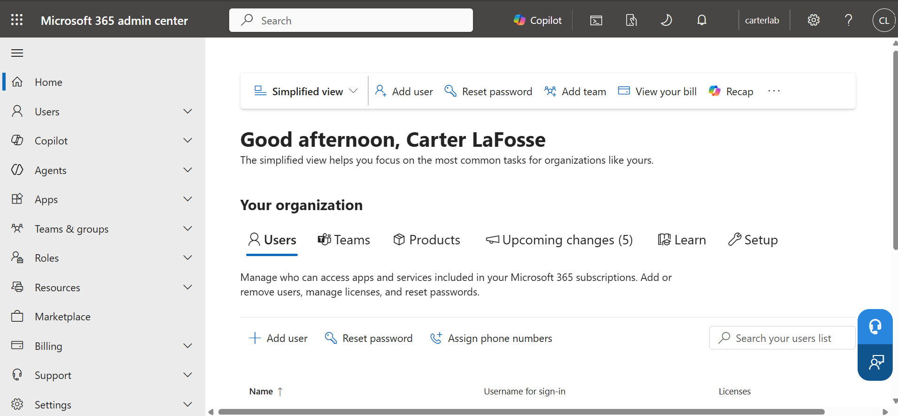
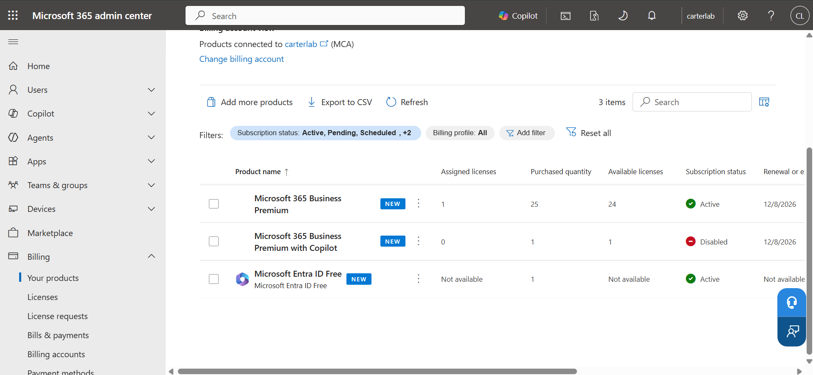

## 1. Users, groups and licences

### Why group-based licensing:
In the on-premises lab, access follows role groups. Add someone to
Lifeguards and the L: drive appears; remove them and it's gone. Licences
work the same way here. Instead of assigning a licence to each person, I
assigned Business Premium to one security group, SG-License-BusinessPremium.
Onboarding a new user becomes one step (add them to the group), and
removing them from the group takes the licence back automatically.

I gave Priya a direct licence on purpose to show the difference. Her
licence page shows the assignment path as Direct, while Jordan's shows
Inherited from the group. In a real tenant, direct assignments are the
ones that get forgotten when someone changes roles or leaves.

### Steps:
1. Created Priya Patel, Jordan Smith and Mei Chen in the Microsoft 365
   admin center, matching their accounts in scripts/users.csv, with usage
   location set to Canada and a forced password change at first sign-in
2. Assigned Business Premium directly to Priya
3. Created the security group SG-License-BusinessPremium in Entra, with
   Jordan and Mei as members
4. Assigned Business Premium to the group from the Microsoft 365 admin
   center (Billing → Licences → Groups). Entra now only displays group
   licences; assigning them has moved to the Microsoft 365 admin center
5. Compared assignment paths in Entra: Direct for Priya, Inherited for
   Jordan
6. Signed in as Jordan in a private window and confirmed Outlook opened

### Problems:
- The first trial I signed up for, Business Premium with Copilot, came
  with only one licence, already assigned to my admin account. Adding a
  user with a licence failed with "You're out of licences." I added the
  standard Business Premium trial from the Marketplace, which came with 25
  licences at $0, moved my admin account onto it and set both trials to
  cancel on expiration so neither converts to a paid subscription.
- New accounts created with "Automatically create a password" show the
  generated password only once, on the final screen. I missed it, so I
  reset the passwords with one I set myself and kept the forced change at
  first sign-in.
- Outlook and the Exchange admin center both failed with server errors
  for the first few hours. Exchange Online was still provisioning the new
  tenant and its mailboxes. Jordan's inbox loaded once that finished.

### Screenshots:

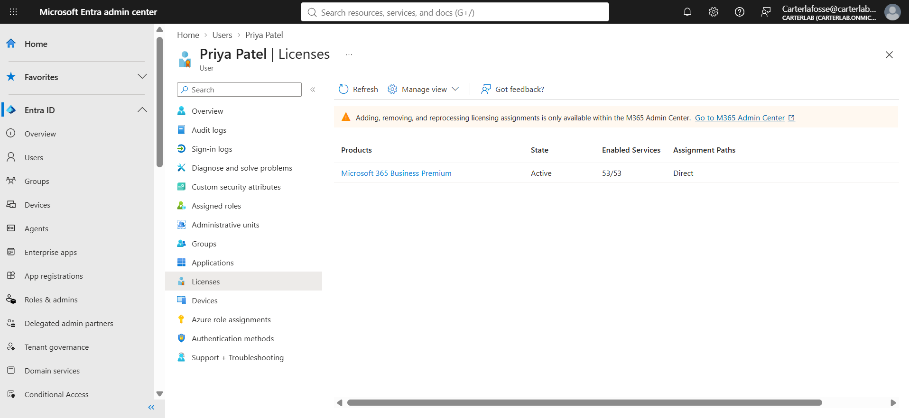

## 2. Passwords and MFA

### Why Conditional Access instead of security defaults:
Security defaults are all-or-nothing: MFA for everyone, with no way to
exclude anyone or adjust what it applies to. Conditional Access lets me
decide who a policy covers, which apps it applies to and what it requires.
I built one policy, CA001, that requires MFA for every user signing in to
any app, with one exclusion: a break-glass account.

The break-glass account is an emergency Global Administrator that the MFA
policy doesn't apply to. If MFA ever breaks, or a policy locks out every
admin, it's how you get back in. Its password is long, stored in a password
manager, and appears nowhere in this repo.

In a real organization I'd run a new policy in Report-only mode first and
check the sign-in logs for anyone it would block, before switching it on.
In the lab I turned it straight on.

The policy is exported as JSON in
[ca-policies/CA001-require-mfa.json](../ca-policies/CA001-require-mfa.json).

### Self-service password reset:
Password resets are the most common help desk ticket, so letting users
reset their own password with MFA cuts a lot of calls. I enabled SSPR for a
pilot group, SG-SSPR-Pilot (Jordan and Mei), rather than everyone, the same
way a real rollout would start small before going company-wide.

The legacy SSPR methods page now only controls security questions, which
Microsoft retires in March 2027. I left them off, since they're easy to
guess or find. The reset method is Microsoft Authenticator, enabled for all
users in the Authentication methods policy, with one method required.
Admins are handled separately: they always have SSPR and need two methods.

### Steps:
1. Reset Mei's password in the Microsoft 365 admin center with a forced
   change at next sign-in
2. Created a break-glass Global Administrator with no licence and a long
   password
3. Turned off security defaults so Conditional Access could take over
4. Created CA001 - Require MFA for all users: all users except the
   break-glass account, all resources, grant access with MFA, enabled
5. Signed in as Mei and was forced to register Microsoft Authenticator
6. Created SG-SSPR-Pilot with Jordan and Mei, and enabled SSPR for that
   group only
7. Confirmed Microsoft Authenticator is enabled in the Authentication
   methods policy and left security questions off
8. Reset Mei's password as Mei at aka.ms/sspr, approving with Authenticator

### Problems:
- I turned off security defaults on Nov 9 but didn't create CA001 until
  Nov 13, so the tenant had no MFA requirement for four days. In a real
  tenant those two steps have to happen back to back.
- Registering Authenticator as Mei failed with "BadRequest" in Chrome
  Incognito, because Incognito blocks the third-party cookies that
  Microsoft's sign-in pages need. It worked after allowing them.

### Screenshots:
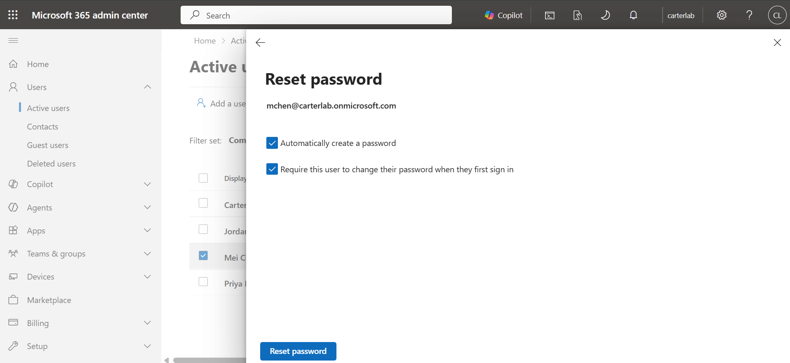
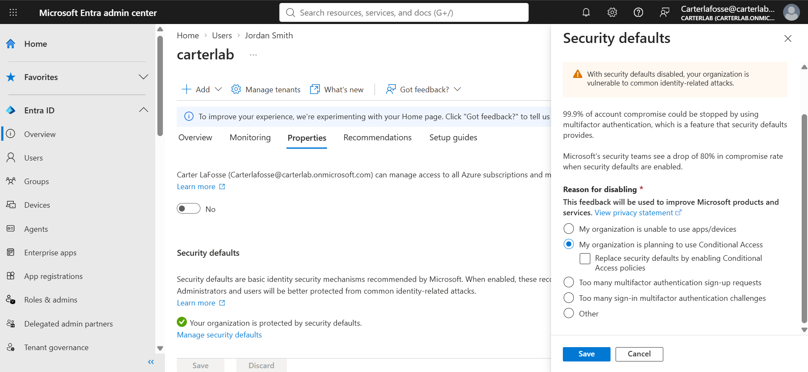
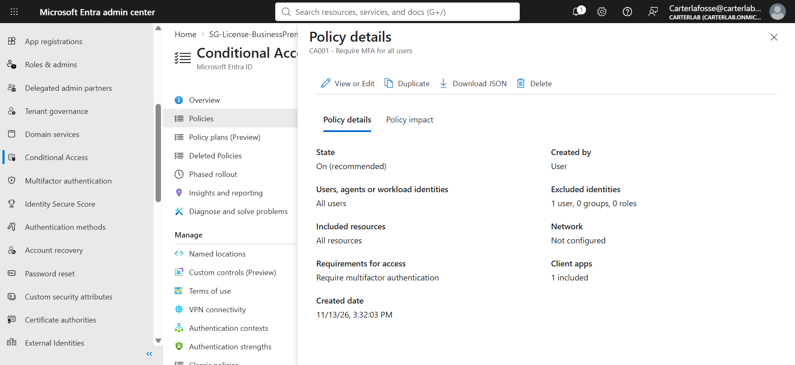
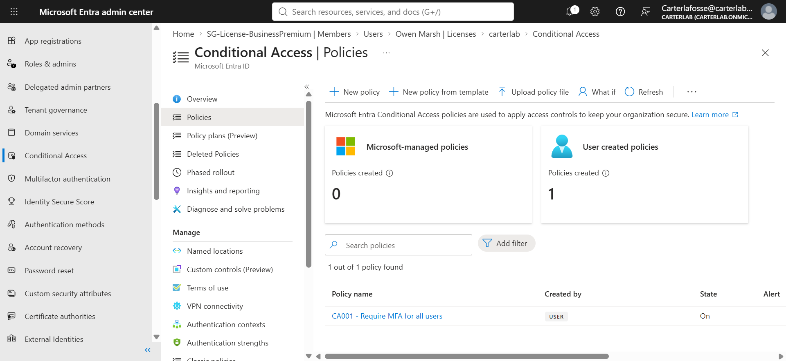

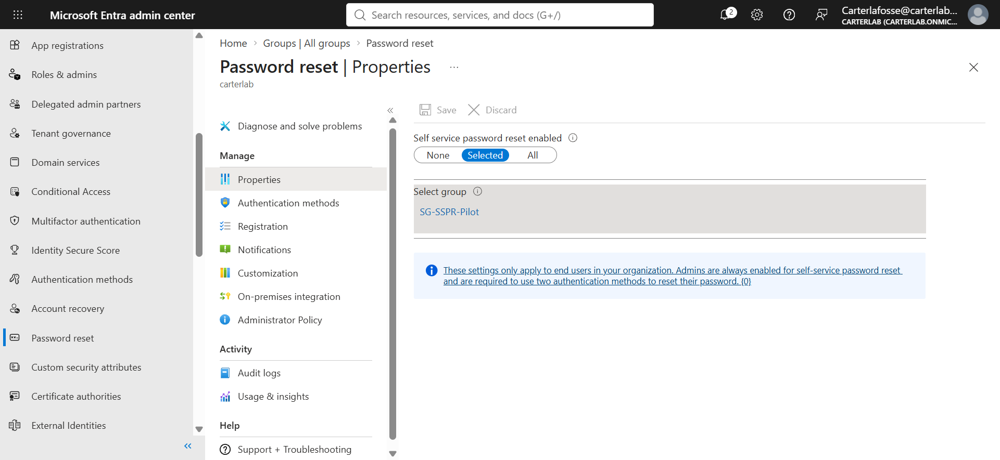
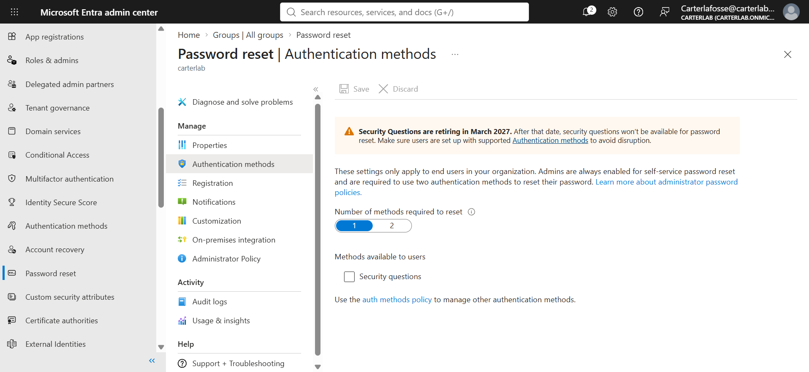
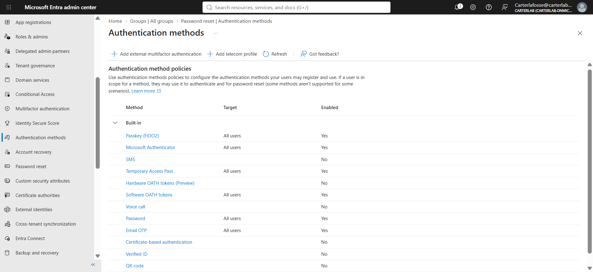
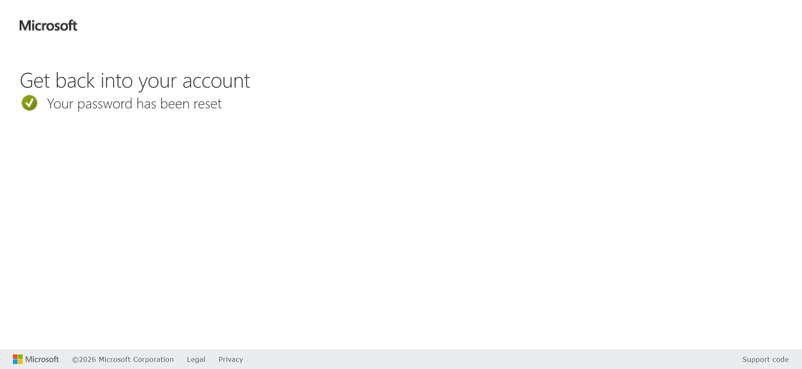

## 3. Exchange: shared mailbox and distribution list
### Full Access vs Send As:
### Steps:

## 4. Offboarding
### Why the order matters:
### Steps: