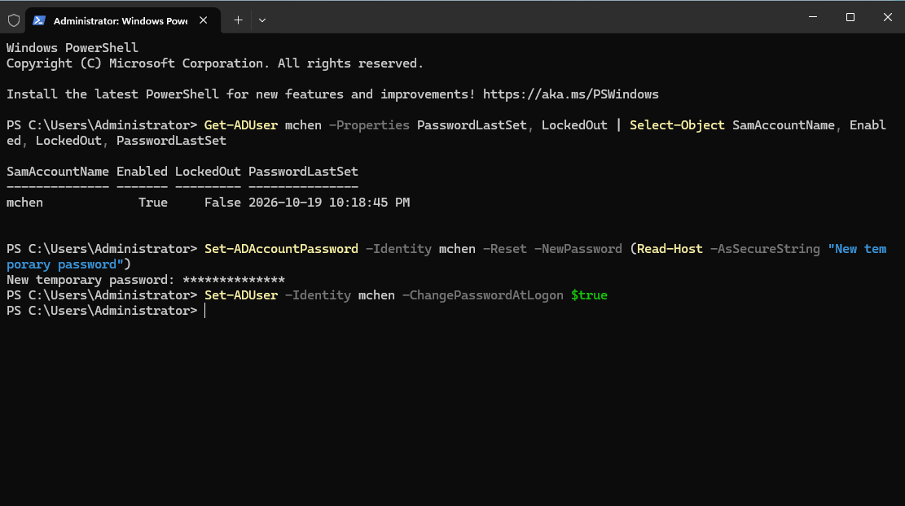
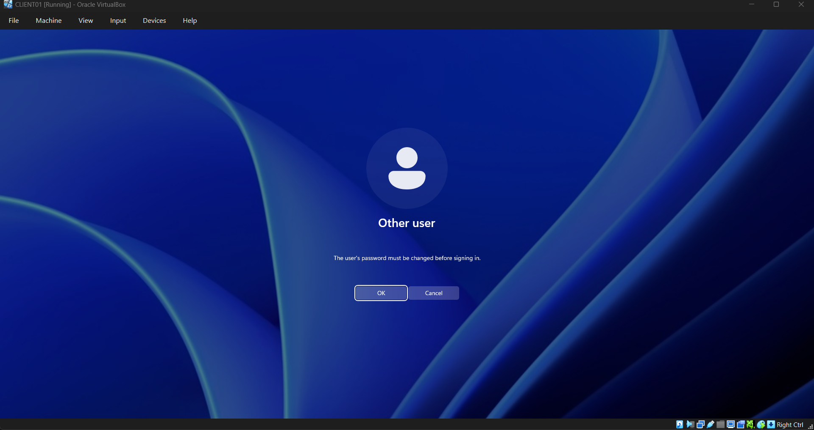
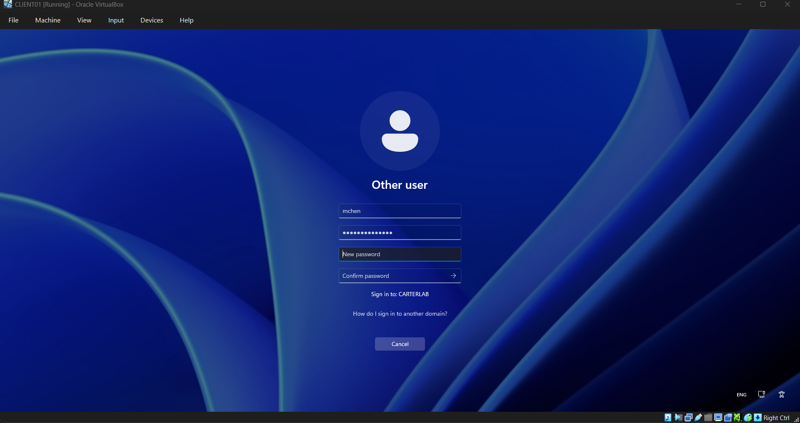
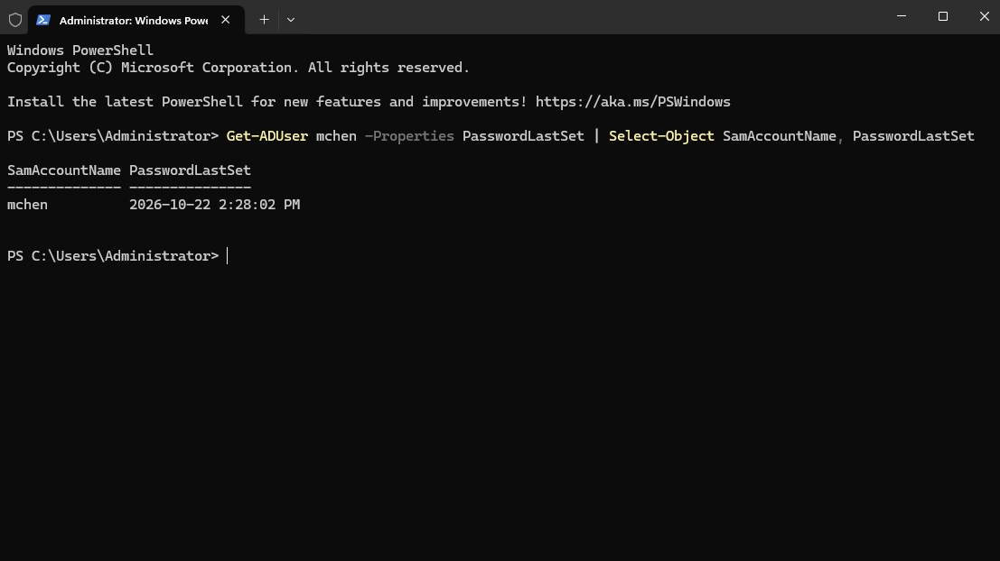

# Ticket 001 — Password reset

**Reported issue:** User mchen, a swim instructor, can't sign in to CLIENT01 and says she's forgotten
her password.

**Identity verification:** Before touching the account I'd confirm the caller
is who they say they are. At most workplaces that means a callback to the number 
on file in the staff record, or confirming details only that person would know
against the HR record. A password reset hands over access to everything the
account can reach, so an attacker phoning the help desk pretending to be a
staff member is one of the cheapest ways into an organization. That being said, 
for the purposes of this lab I noted the step rather than performing it.

**Investigation:** `Get-ADUser mchen -Properties PasswordLastSet, LockedOut`
This command showed the account Enabled and not locked out, with PasswordLastSet 
dated to when the account was created in Phase 5 of my project. So this is a forgotten 
password, not a lockout and not a disabled account which are different problems with
different fixes.

**Root cause:** User forgot her password. No system fault.

**Resolution:** I reset the password with `Set-ADAccountPassword -Reset`, typing
the temporary password into a secure prompt rather than putting it in the
command. That way it doesn't end up in the PowerShell history. Then, I set
`-ChangePasswordAtLogon $true` so she must choose her own password at first
login and the temporary one is single-use. Then I went and confirmed on CLIENT01 
that she was prompted to change it and could sign in afterwards.

**Prevention:** The forced change means IT never knows the user's working
password, which is the point. For a user who forgets regularly, self-service
password reset would remove the help desk from the loop entirely. Something worth
noting was the temporary password still has to meet the domain policy of 12 characters
with complexity, so it can't be something trivial.

**Time to resolve:** 5 minutes