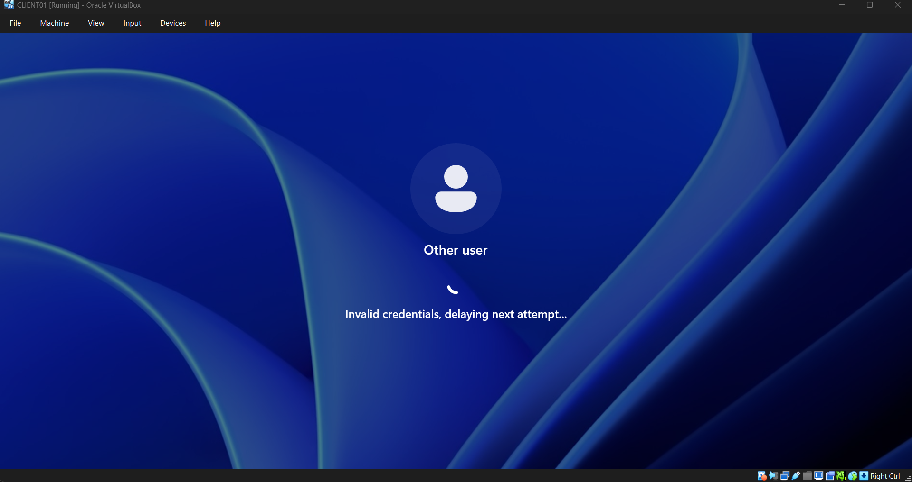
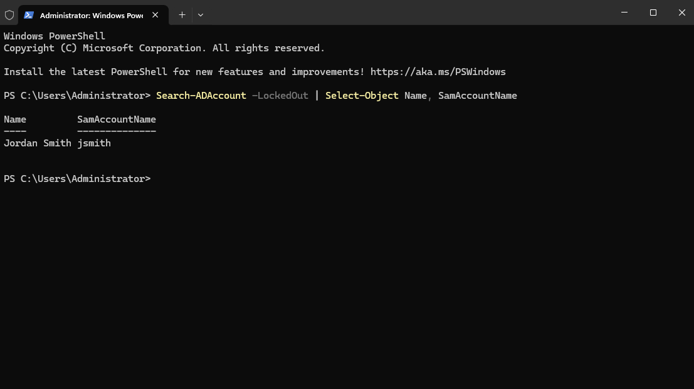
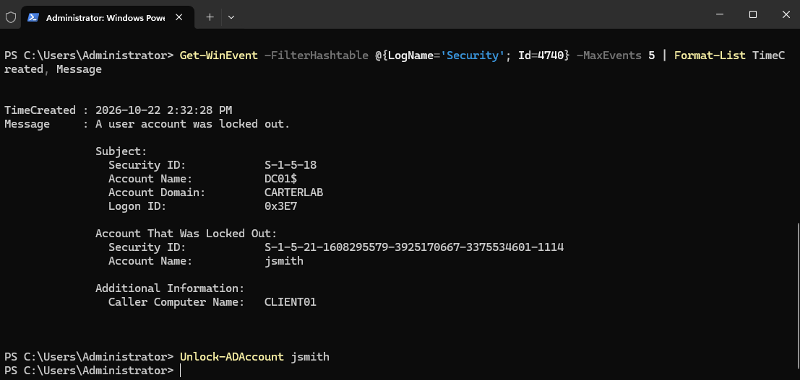
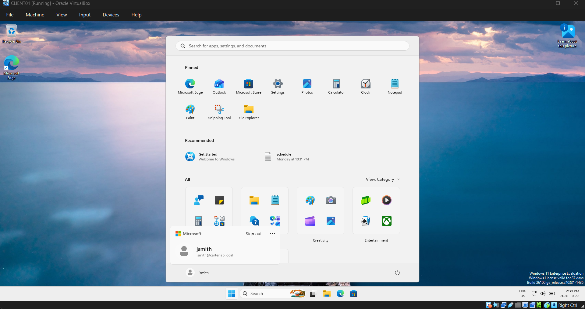

# Ticket 002 — Account locked out

**Reported issue:** User jsmith, a lifeguard, can't sign in to CLIENT01. She says the
password is correct and she hasn't changed it. The sign-in screen tells her
the account is locked.

**Identity verification:** Same as a reset, first always confirm the caller
against the number on file before making changes. Unlocking an account is less 
dangerous than resetting a password, since the attacker would still need the 
password, but it's exactly what someone would ask for if they'd triggered the 
lockout themselves while guessing.

**Investigation:**
Command `Search-ADAccount -LockedOut` on DC01 returned jsmith, which confirmed 
the user's description rather than relying on it.

`Get-ADUser jsmith -Properties BadLogonCount, LastBadPasswordAttempt,
AccountLockoutTime` showed five bad attempts, with the last one and the
lockout time seconds apart. That matches the Phase 6 policy that I looked at 
exactly: threshold of five, lockout for fifteen minutes.

Security log event **4740** named the source computer as CLIENT01. One user at
one machine is a person mistyping; the same account locking out repeatedly from
a machine the user has never touched is a stale saved credential or someone
guessing.

**Root cause:** Five failed sign-in attempts in a short window hit the lockout
threshold. The policy did what it was configured to do. No fault in AD, the 
client, or the account.

**Resolution:** Command `Unlock-ADAccount -Identity jsmith`, then confirmed 
LockedOut returned False and I signed in as her successfully on CLIENT01. No 
password reset was needed, the password was never the problem, so resetting it 
would have created extra work for the user for no reason.

**Prevention:**
- I would check Caps Lock with the user, which is the most common cause.
- The account would also have unlocked itself after fifteen minutes. Telling
  the user that is often faster than a call, though in a real workplace most
  people would rather have it unlocked now.
- If the same account locks out repeatedly, the fix isn't more unlocking.
  Event 4740's source computer is where to start looking for a saved
  credential somewhere the user has forgotten about.

**Time to resolve:** 10 minutes