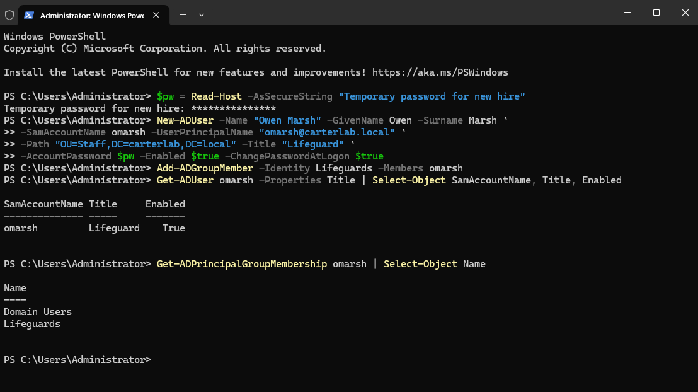
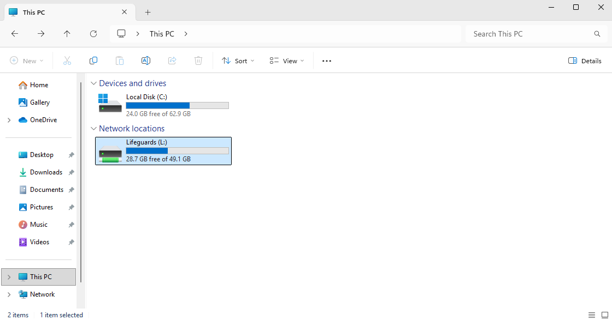

# Ticket 003 — New hire needs an account and share access

**Reported issue:** Request from the aquatics supervisor for an account for
Owen Marsh, a new lifeguard starting soon. He needs to be able to sign in
to the front desk PC and reach the Lifeguards shared drive.

**Identity verification:** Account creation requests get verified differently
from password resets, I wouldn't be looking to know: "are you who you say you
are", but "are you allowed to ask for this". In this scenario, after confirming
the request came from the aquatics supervisor, who owns that team, rather than
from the new hire or a colleague. In a real environment this would arrive through
HR onboarding or a ticket from an authorized requester, not a verbal ask.

**Investigation:** Nothing broken. This is a provisioning request rather than
a fault. The relevant question is which access the role needs, not which
access the person asks for. A lifeguard needs what every lifeguard has.

**Resolution:** Created the account with `New-ADUser` in the Staff OU, title
Lifeguard, with a temporary password typed into a secure prompt and
`-ChangePasswordAtLogon` set. Added him to the Lifeguards security group with
`Add-ADGroupMember`.

No Group Policy was touched. The drive map GPO already applies to everyone in
Staff, and its item-level targeting checks membership of Lifeguards, so adding
him to the group was the entire access change. Confirmed on CLIENT01: he was
forced to set his own password at first login, and L: appeared with
schedule.txt in it.

Also added his row to scripts/users.csv so the file stays an accurate record
of who exists in the lab.

**Onboarding checklist**

1. Confirm the request comes from someone authorized to ask, manager or HR,
   not the new hire or a teammate.
2. Confirm start date, full name, job title and team before creating anything.
3. Create the account in the OU for that team, following the existing naming
   convention (first initial plus surname).
4. Fill in title and department.This makesmthe directory searchable and what
   later access reviews are judged against.
5. Grant access by adding to role groups only. Never grant a permission
   directly to a user account, it becomes invisible in six months.
6. Set a temporary password with forced change at first login, so IT never
   knows the working password.
7. Verify by signing in as the user and confirming the expected resources
   appear. Don't declare it done because the commands returned without error.
8. Hand the temporary password to the user through a channel that isn't the
   same one the request arrived on, and never by email in plain text.
9. Record what was granted in the ticket, so there's a trail if the access is
   ever questioned.
10. The same list run backwards is the offboarding process. Accounts that
   linger after someone leaves are one of the most common audit findings,
   which is another argument for group-based access: removing someone from
   their groups removes everything at once.

**Prevention:** Not applicable, this is routine provisioning. The thing worth
protecting against is called scope creep where you grant "while I'm in here"
extras that nobody later remembers approving. Sticking to role groups makes 
that hard to do by accident.

**Time to resolve:** 10 minutes