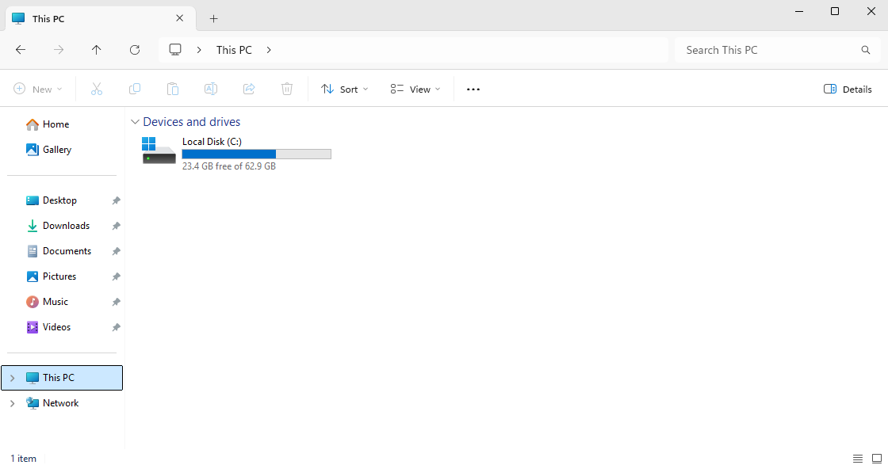
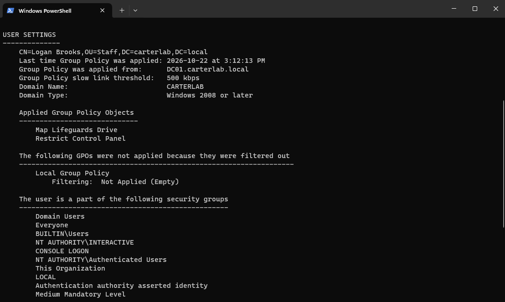
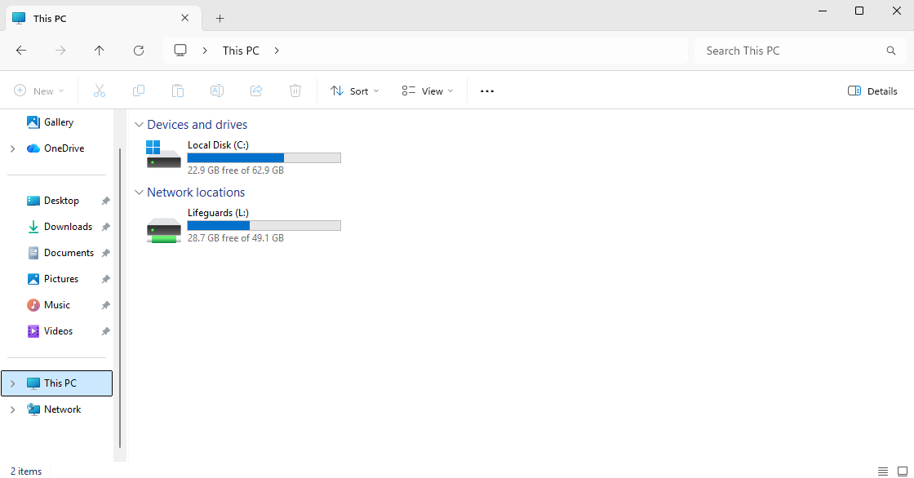

# Ticket 004 — Mapped drive missing

**Reported issue:** User, lbrooks, a lifeguard, says his L: drive has 
disappeared. It was there before, nothing else seems wrong, and he can 
sign in normally.

**Identity verification:** In this scenario I would confirm the caller
against the number on file. No account changes were needed to diagnose this,
but the investigation exposes a user's group memberships, which in a real
situation, wouldn't be something to read out to the caller.

**Investigation:**

Started on the client, because "my drive is gone" could mean the mapping
failed, the share is down, or the user's access changed.

`gpresult /r` as lbrooks listed **Map Lifeguards Drive** under Applied Group
Policy Objects. That ruled out a lot in one step: the GPO is reaching him, so
this isn't a delivery, link, filtering or replication problem.

The same output has a section further down, "The user is a part of the
following security groups", and `CARTERLAB\Lifeguards` wasn't in it. Only
Domain Users and the built-in groups everyone gets. Confirmed independently
with `whoami /groups`, which showed the same.

So the GPO applied and the drive still didn't appear. That points at the
item-level targeting inside the preference rather than the policy itself: the
condition is "user is a member of CARTERLAB\Lifeguards", and the condition
wasn't met.

Confirmed from the directory side on DC01:

- `Get-ADUser lbrooks -Properties MemberOf` returned nothing at all. An empty
  MemberOf excludes the primary group, so no output means no group memberships
  beyond Domain Users.
- `Get-ADGroupMember Lifeguards` returned users jsmith, ppatel and omarsh. 
  lbrooks absent.

This is two perspectives of the same thing.

I also checked the share itself with `Get-SmbShare Lifeguards` so it could be
ruled out rather than assumed.

**Root cause:** The user had been removed from the Lifeguards security group.
Group Policy worked correctly throughout. The drive map is deliberately
conditional on that membership, and the condition was no longer true. Nothing
was broken; the access had changed.

**Resolution:** `Add-ADGroupMember -Identity Lifeguards -Members lbrooks`.

With lbrooks still signed in, `gpupdate /force` did **not** bring the drive 
back. It only reappeared after he signed out and signed back in.

The reason is that group membership is fixed into the Kerberos ticket issued
at logon. That ticket carries the list of groups the user belongs to and
isn't rebuilt mid-session. On gpupdate, Group Policy re-evaluated the
preference, checked the session's group list, still found no Lifeguards, and
skipped the drive map again. Only a fresh logon requests a new ticket
reflecting the change.

**Prevention:**
- The removal was deliberate here. In reality the next question after
  fixing it would be who removed him and whether that was intended. Auditing on
  group membership changes answers that; without it, a mistaken removal and a
  malicious one could look identical.
- In practice, access changes should land at predictable times rather than 
  mid-shift, so people aren't surprised by a missing drive while working.
- The diagnostic order generalizes: check what the user's session actually
  has, then check what the directory says they should have. The gap between
  the two is the fault.
- A caution for next time: `gpresult /r` saying a GPO is "Applied" is true and
  still not the whole story. A GPO can apply completely while a preference
  inside it does nothing, because item-level targeting is evaluated per item.
  Stopping at the Applied list would have sent me looking at the share or the
  network, in entirely the wrong place.

**Time to resolve:** 15 minutes