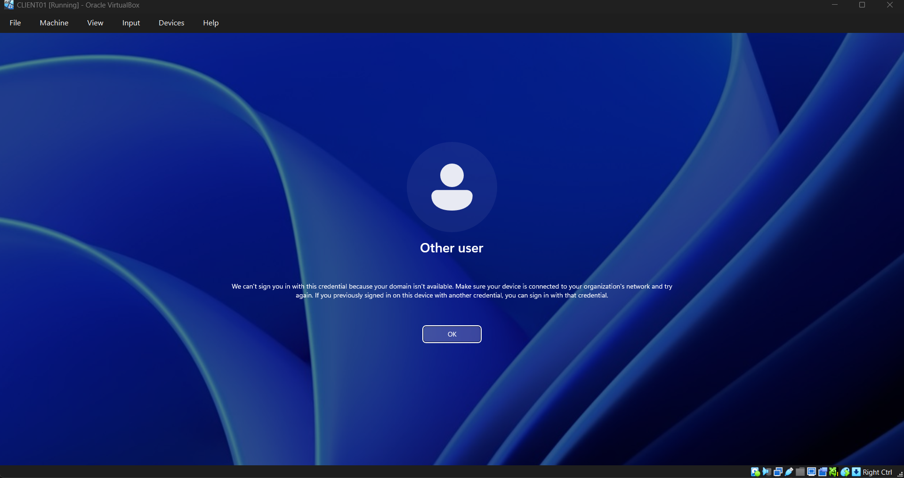
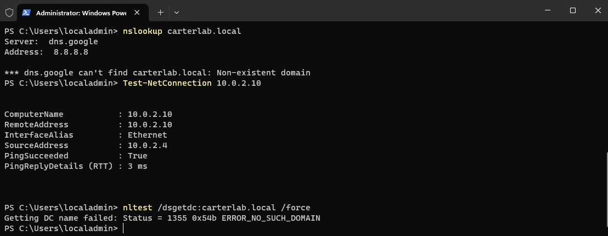
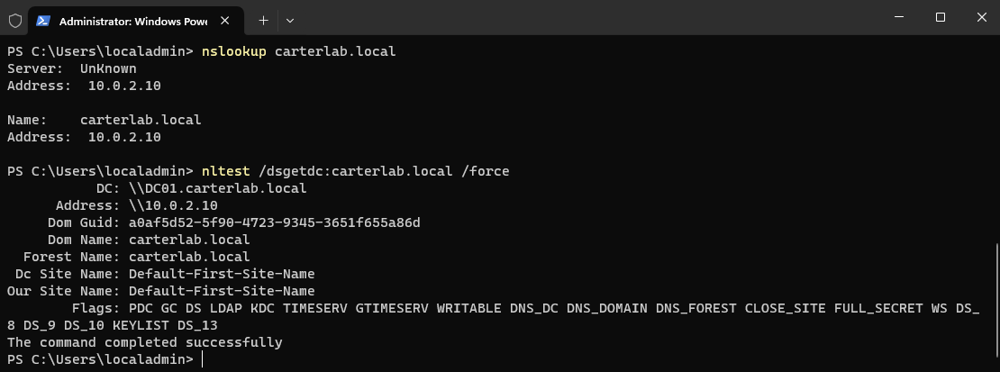
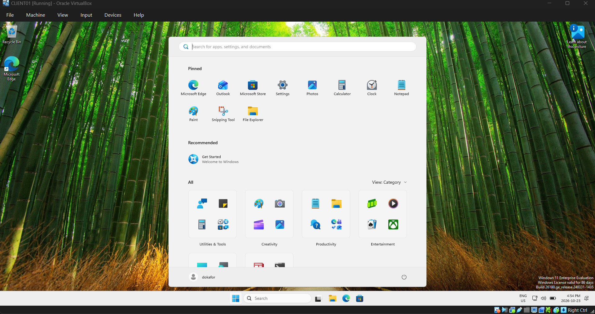

# Ticket 005 — "There are currently no logon servers available"

**Reported issue:** User, dokafor, a newly hired swim instructor, can't sign
in to CLIENT01. The error reads "There are currently no logon servers
available to service the logon request." Colleagues who use the same machine
are getting in without trouble.



**Investigation:**

The important thing to note here was: "it works for some people but not
others". That rules out a single broken account because a disabled or locked 
userwouldn't affect anyone else and it also rules out a dead machine, because 
then nobody would get in. Meaning something is partially failing.

Four checks on CLIENT01:

| Command | Result | What it tells me |
|---|---|---|
| `ipconfig /all` | DNS Servers: 8.8.8.8 | Not the domain controller. First red flag |
| `nslookup carterlab.local` | "dns.google can't find carterlab.local: Non-existent domain" | Name resolution for the domain is broken |
| `Test-NetConnection 10.0.2.10` | PingSucceeded: True, 3 ms | The network path to DC01 is completely fine |
| `nltest /dsgetdc:carterlab.local /force` | ERROR_NO_SUCH_DOMAIN | Windows cannot locate a domain controller |



Rows three and four together are the diagnosis. The machine can **reach**
DC01 perfectly well but cannot **find** it. Connectivity and name resolution
are separate layers, and only the second one is broken.

8.8.8.8 is Google's public resolver. It knows the public internet and has
never heard of carterlab.local, which exists only in DC01's DNS. Without
those SRV records there's no way to discover a domain controller, so the
logon request has nowhere to go.

**Why the first reproduction didn't fail**

After setting DNS to 8.8.8.8 and restarting, the first user I tried logged in
normally. `nslookup` was already failing at that point, so something else was
finding the domain controller.

Running `nltest /dsgetdc:carterlab.local` **without** `/force` returned DC01
successfully, complete with its name, IP and site. Adding `/force` returned
ERROR_NO_SUCH_DOMAIN. The difference is the **DC Locator cache**: Windows
remembers which domain controller it found last time instead of rediscovering
on every request. The cached entry held DC01's address, the network path
still worked, so authentication went straight there without DNS being
involved at all.

So there are several layers of resilience sitting between a DNS failure and a
user noticing:

- the **DC Locator cache**, which remembers where the DC was
- **cached credentials**, which let previously signed-in users authenticate
  with no DC at all — the feature that makes laptops work offline
- a **flat network**, where the client and DC share a subnet and are directly
  reachable

That's why a total DNS failure presents as an intermittent problem. It hits
new logons and new machines first, and the people who were already working
notice nothing for hours.

Clearing the locator cache with `/force` and restarting the Netlogon service
produced the clean failure: a user who had never signed in on CLIENT01 got
the "no logon servers available" error, exactly as reported.

**Root cause:** The client's DNS server had been set to a public resolver
instead of the domain controller, so the machine could not locate a domain
controller for authentication.

**Resolution:**

```powershell
Set-DnsClientServerAddress -InterfaceAlias "Ethernet" -ServerAddresses 10.0.2.10
Restart-Computer
```

After the restart, `nslookup carterlab.local` resolved to 10.0.2.10,
`nltest /dsgetdc:carterlab.local /force` returned DC01, and the affected user
signed in normally.





**A lockout I caused myself**

While DNS was broken I tried to log in as CARTERLAB\Administrator to fix it,
and got the same "no logon servers" error. That account had never signed in
on CLIENT01, so there were no cached credentials for it and no DC to validate
against. Domain credentials were useless on that machine.

The only way back in was the local administrator account, which I was able to
sign in with and fix the issue.

**Prevention:**
- Domain-joined clients should take DNS from DHCP pointing at the domain
  controller, never a hardcoded public resolver. If internet name resolution
  is the goal, the right fix is a forwarder on the DNS server, which is what
  Phase 4 configured, not bypassing internal DNS at the client.
- Someone set this manually. In production, one hardcoded resolver usually
  means several, so the next step would be checking whether other machines
  have the same change.
- Keep a working local admin credential on every machine, for the reason
  above.
- When Active Directory misbehaves, check DNS first. AD depends on DNS for 
  everything, so a lot of "AD problems" are DNS problems in disguise.

**Time to resolve:** 45 minutes, most of it spent working out why the fault
wouldn't reproduce.