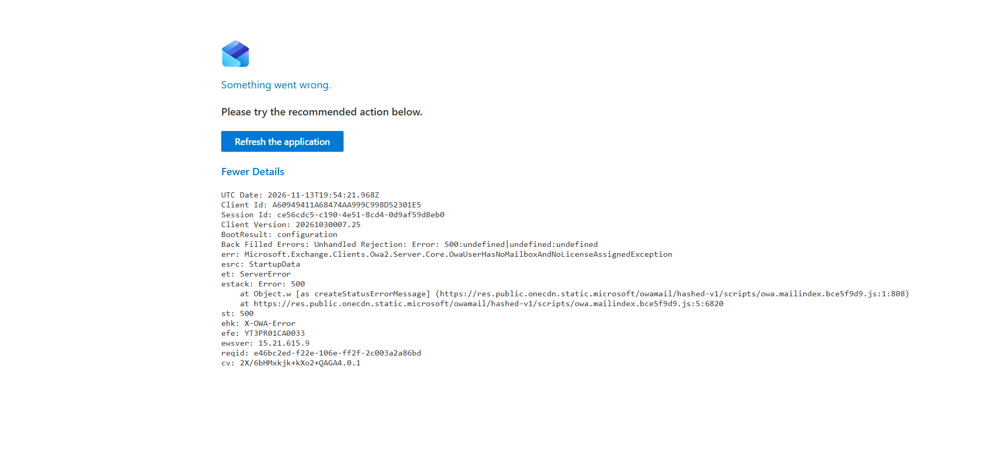
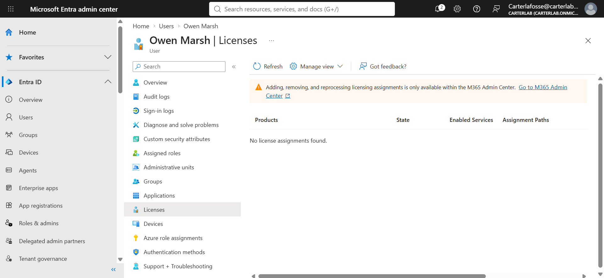
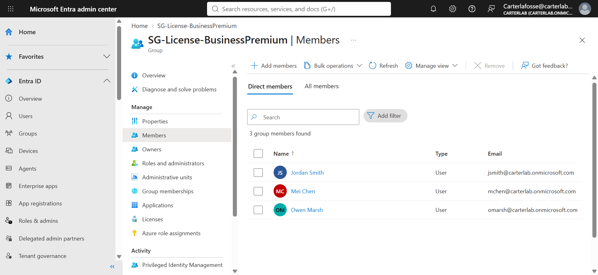
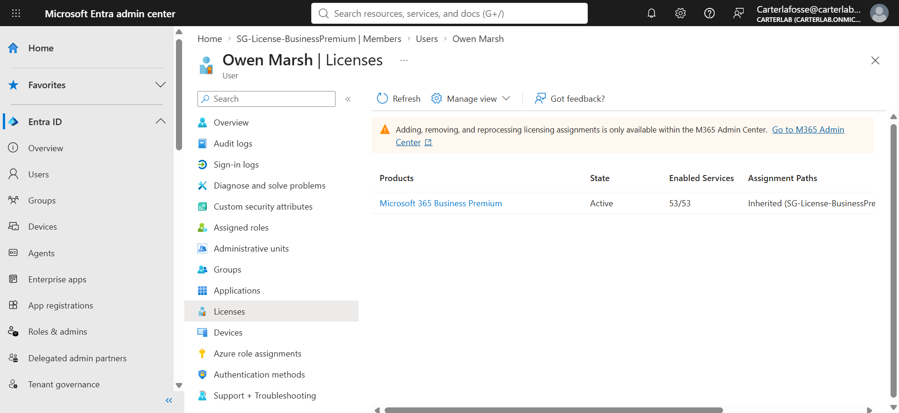
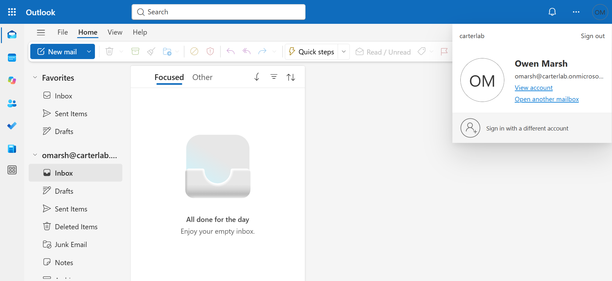

# Ticket 006 — New hire has no Outlook licence

**Reported issue:** Owen Marsh, the new lifeguard from ticket 003, signed in
to Microsoft 365 on his first day and couldn't open Outlook. His account
worked, but there was no mailbox.

**Identity verification:** Owen had already signed in successfully and was
calling about his own account, so the check was the usual one for a
self-reported issue: confirm his name and username against the directory.
Nothing was being reset or granted that he could misuse, since the fix only
gives him what every lifeguard already has.

**Investigation:** Started from what the user saw, then worked back to the
account. Owen could sign in, so the account itself and his password were
fine. That pointed away from authentication and toward what the account was
entitled to.

In Entra, his Licences page was empty. Without a Microsoft 365 licence there
is no Exchange Online mailbox, so Outlook has nothing to open. Checking his
group memberships showed why: he had never been added to
SG-License-BusinessPremium, the group that hands out Business Premium
licences. The account had been created, but the onboarding step that grants
the licence was skipped.

**Resolution:** Added Owen to SG-License-BusinessPremium. I didn't assign a
licence to him directly, because licences in this tenant follow the group,
the same way the L: drive follows the Lifeguards group in the on-premises
lab.

About three minutes later his Licences page showed Business Premium as
Active, with the assignment path Inherited from the group. Confirmed from
his side by signing in again: Outlook opened with his mailbox.

**Prevention:** This is a process gap, not a system fault. The fix is to add
"add to SG-License-BusinessPremium" to the onboarding checklist from ticket
003, right after creating the account. Two related things worth knowing:

- A licence can't be assigned at all if the user has no usage location set,
  which is a common cause of the same symptom.
- A brand-new mailbox can take a while to appear after the licence lands.
  If the licence shows as Active but Outlook still errors, give Exchange
  time before troubleshooting further.

**Time to resolve:** 10 minutes, including about 3 minutes for the licence
to apply