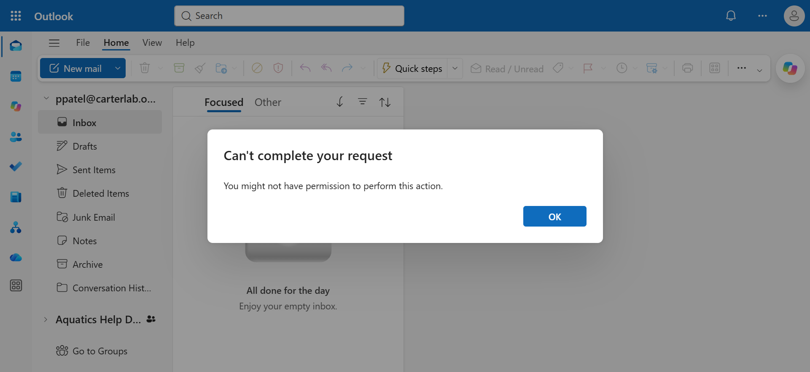
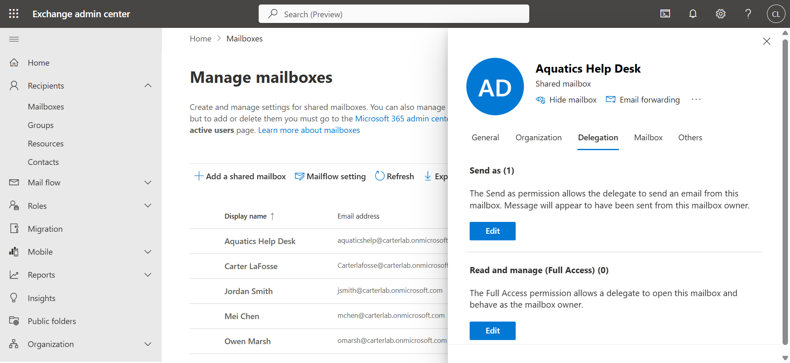
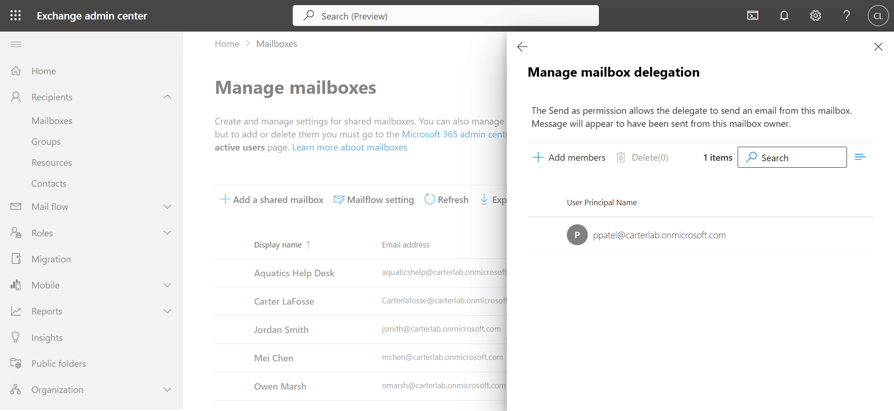
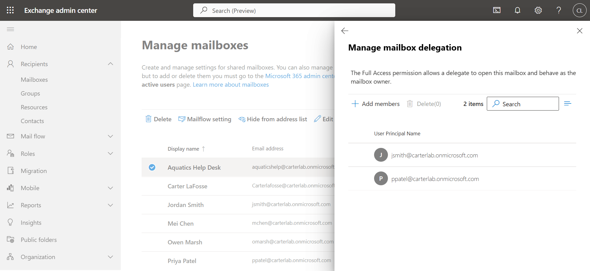
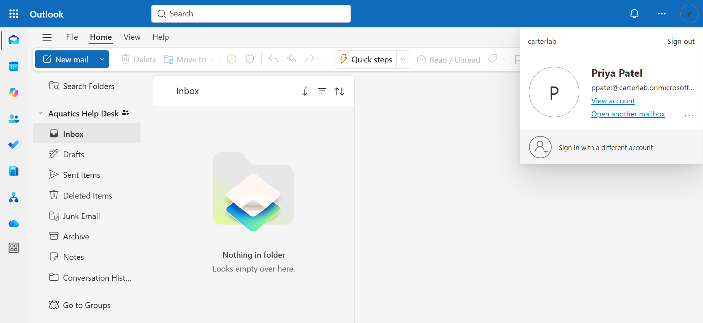

# Ticket 007 — Can't open the shared help desk mailbox

**Reported issue:** Priya Patel, a head lifeguard, was asked to help
monitor the Aquatics Help Desk inbox. She added it in Outlook on the web,
but clicking it gave "Can't complete your request. You might not have
permission to perform this action."

**Identity verification:** Priya was signed in and asking about access she
had been told she'd have. The check that mattered was whether the access
was approved: confirming with the aquatics supervisor, who owns the
mailbox, that Priya should be able to read it, not just send from it.

**Investigation:** The mailbox appeared in her folder pane, so Outlook knew
it existed. The error only came when she tried to open it, which pointed
at permissions rather than the mailbox itself.

In the Exchange admin center, the mailbox's Delegation tab showed Send as
with one member and Read and manage (Full Access) with none. Priya was the
Send as member. She had been given permission to send from the mailbox but
not to open it.

**Resolution:** Added Priya under Read and manage (Full Access), keeping
her Send as permission.

Full Access can take up to an hour to apply in Outlook. Once it did, she
could open Aquatics Help Desk and its inbox from her own account.

**Prevention:** Send as and Full Access are separate permissions, and
someone asking for "access to the shared inbox" almost always needs both.
Granting them together in one request avoids this ticket. For a larger
team, a mail-enabled security group holding both permissions would mean
adding a person to one group instead of editing the mailbox each time.

**Time to resolve:** 10 minutes of work, plus waiting up to an hour for
the permission to apply