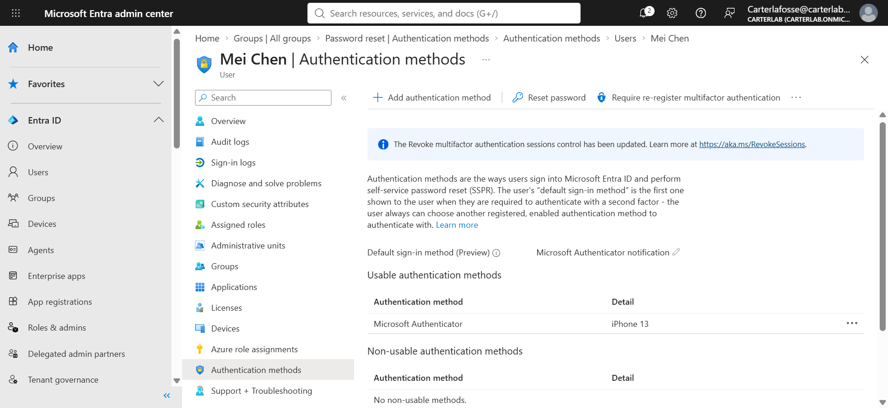
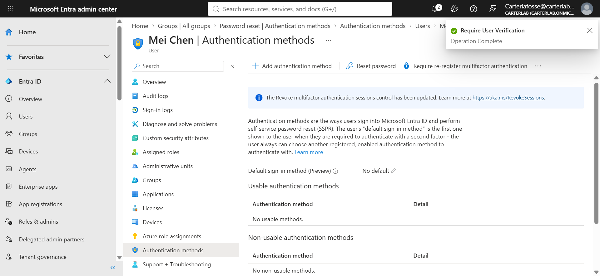
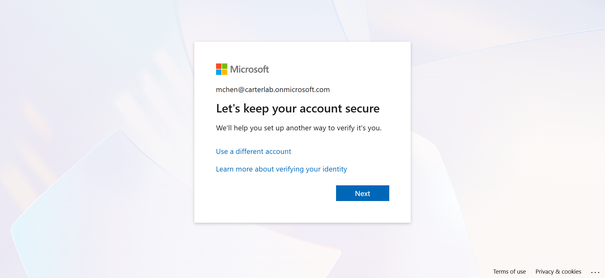

# Ticket 008 — New phone, can't complete MFA

**Reported issue:** Mei Chen called to say she'd replaced her phone. Her old
one was wiped and traded in, so when she tried to sign in to Outlook she
couldn't approve the Microsoft Authenticator notification, and was stuck at
the MFA prompt.

**Identity verification:** This is the ticket where verification matters
most. Resetting someone's MFA hands their account to whoever is on the
phone, which is exactly how attackers take over accounts through a help
desk. Before touching anything I'd confirm it really is Mei, by calling her
back on the number in the directory rather than the one she called from,
or by confirming the request with her manager. For a password reset in
ticket 001 the risk is lower, because MFA still protects the account. Here
the MFA is the thing being removed.

**Investigation:** Her password was fine; she was getting past that step.
In Entra, her Authentication methods page showed Microsoft Authenticator
registered to her old phone, and nothing else. With only one method on the
account and that device gone, there was no way for her to complete MFA.

**Resolution:** After verifying her identity, used Require re-register
multifactor authentication on her account. That cleared the old
registration, leaving her with no usable methods, so her next sign-in would
ask her to set MFA up again.

Also revoked her sessions, so anything still signed in on the old device
was signed out. When she signed in again she got the setup prompt, added
Authenticator on her new phone and got into Outlook.

**Prevention:** One MFA method is a single point of failure. Two fixes:

- Have users register a second method at onboarding, such as Authenticator
  on a second device or a phone number, so losing one doesn't lock them out.
- Use a Temporary Access Pass for cases like this. It's a time-limited code
  IT can issue after verifying identity, letting the user sign in once and
  register their new phone themselves. It's already enabled in this tenant.

**Time to resolve:** 15 minutes, including identity verification